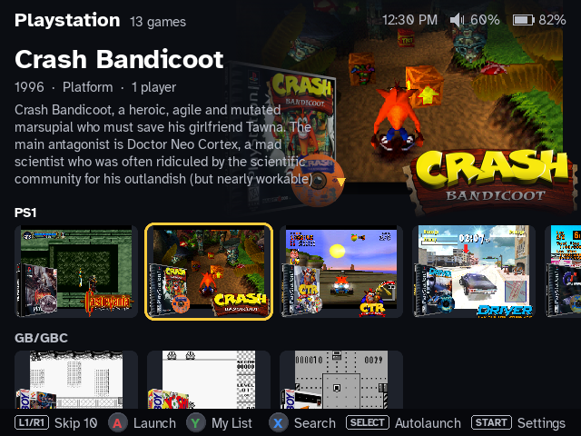
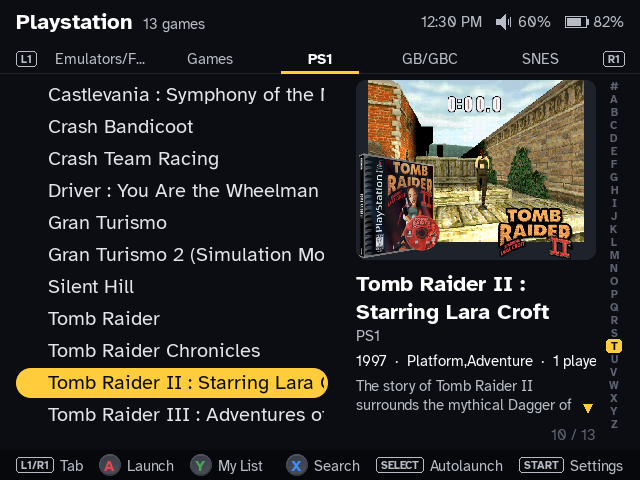
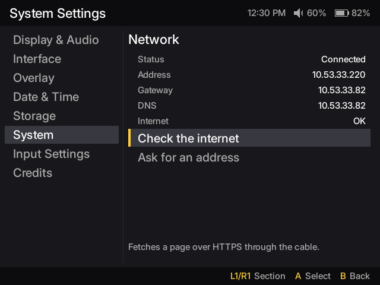
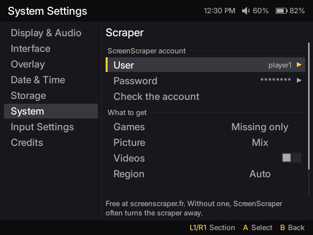
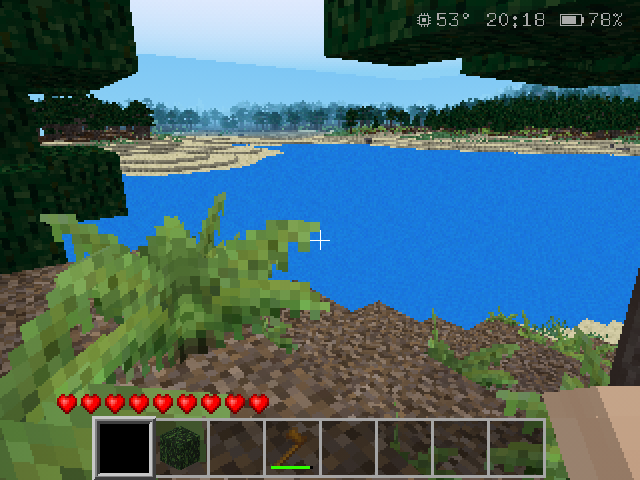
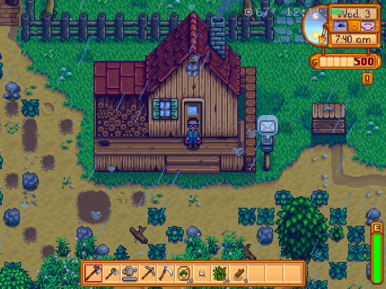
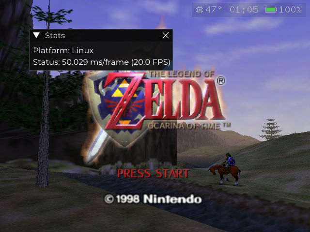
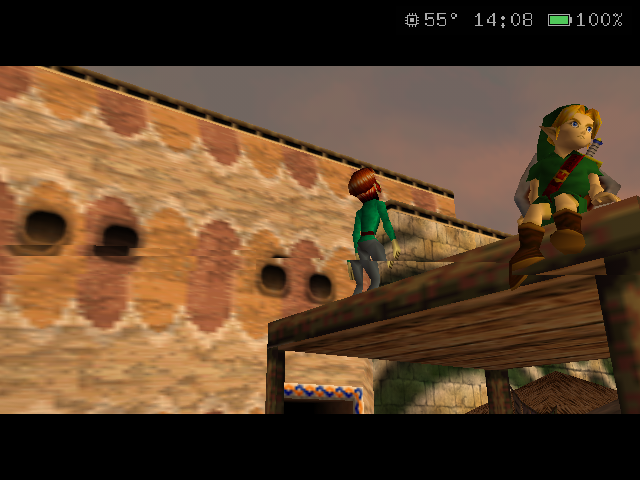

# goodluckOS
[](https://github.com/alvesmaicon/goodluckOS/actions/workflows/kernel.yml) [](https://github.com/alvesmaicon/goodluckOS/actions/workflows/rootfs.yml)

An uncompromisingly fast, small, modern, and feature-rich custom firmware for A23/A33-based handheld consoles.

> [!IMPORTANT]
> **This is not a goodluckOS distribution.** For goodluckOS, use the official project: [CodeZombie/goodluckOS](https://github.com/CodeZombie/goodluckOS).
>
> This fork is my personal workspace. I use it to improve my own console (a GA36-MB v1.1, A33) and to prepare contributions, which I offer upstream as small pull requests, only the ones Jeremy wants. It is not meant to compete with goodluckOS or to be installed by anyone else: there are no releases or images here, and none are planned. Everything in it was written with an AI coding assistant (Claude Code), has only run on my device, and is still being reviewed. What it changes, and where each change stands, is in the [fork status](https://github.com/alvesmaicon/goodluckOS/discussions/3) discussion.

> [!IMPORTANT]
> **goodluckOS is BETA software. You will run into bugs!**
>
> Please visit [The Firmware Builder](https://codezombie.github.io/goodluckOS/download.html). This will walk you through the steps of identifying if you have a compatible unit, and building a flashable goodluckOS image.

## Features
- Mainline Linux 7.2
- Everything compiled from scratch with the best optimization flags for the hardware
- Optimized for performance. No systemd, no unecessary background processes, no x11/wayland
- Significantly smaller and faster than the stock firmware
- Boots in 10 seconds (stock firmware takes 50)
- Can be flashed to a 1gb SD card and still give you over 500mb of free space for games
- ZRAM enabled by default
- Hardware accelerated graphics
- Speaker and headphone audio. The speaker gets a high-pass filter, so it stays clean instead of distorting on bass it can't play
- Great battery life
- A low battery warning over any game at 15% and 5%. At 2% the game is closed, saving as when you quit it, and the console shuts down cleanly before the battery cuts out
- No swap on SD card (massively improves the life of your card over the stock f/w)
- `Resize Home` (System Settings -> Storage) grows your HOME partition to fill all the available space on your microSD card.
- Volume buttons change the volume and FN+Vol the screen brightness from anywhere, with a level bar shown over whatever is on screen: the launcher, the settings or any game
- A status bar with the CPU and power chip temperatures, the date and time, the battery, the volume and the audio output: the launcher's top bar, and optionally over any game, with the same items
- Date and time with a time zone, kept while the console is off, shown in the status bar (12/24-hour, several date formats)
- Brightness, volume and CPU mode are kept across reboots
- SELECT+START closes the active application cleanly (RetroArch saves first), bringing you right back to the launcher
- FN+START+SELECT force-kills the active application
- FN+DPAD_UP toggles a live FPS/CPU graph for monitoring in-game performance. What it shows, its style and its corner are set in System Settings -> Overlay.
- FN+DPAD_DOWN switches the sound between the speaker and the headphones only (the console can't detect the headphone jack)
- If the screen is on, the LEDs are off. Nothing blinding you while you're playing in the dark
- Comes stock with Chocolate Doom, ready to play
- Comes with Luanti, a block-building game in the style of Minecraft: Minetest Game with mods that bring it close to Minecraft, from its monsters, villages and horses to the Nether and the End, played with the console's buttons (see [Luanti](#luanti))
- Second SD card (TF-2 slot) for more games, with its own launcher tab
- Music and video player (mpv): Music and Videos tabs in the launcher, played full screen with the console's buttons, with speed (0.25x to 2x) and zoom (up to 4x, moved with the right stick) for videos
- Comes stock with Retroarch and several optimized cores (PCSX-ReArmed, Snes9x, QuickNES, DOSbox, Genesis Plus GX, mGBA, etc)
- Games perform very well. Metal Gear Solid 1 is completely playable at reasonable framerates
- Comes with a custom, optimized launcher application, with tabs per system, search, favourites, play time and game artwork/descriptions from `gamelist.xml`
- System Settings, in the launcher: brightness, volume, audio output, launcher options, language, interface font, overlay, date and time, storage (second card, trash, Resize Home), power mode (Battery saver, Balanced, Performance), system info, a button tester and a restore of the default settings
- Translatable interface, with English and Brazilian Portuguese included (see [Translations](#translations))
- Autostart any application on boot, including games or a front-end like EmulationStation (coming soon)
- USB terminal access for remote debugging. Log in with `sudo screen /dev/ttyACM* 115200` and `root:root`
- HOME shows up on your PC over USB (MTP), like a phone: copy games and saves without taking the SD card out
- Internet over the same USB cable: the PC shares its connection with the console (CDC NCM, no driver to install), in place of MTP while it's on
- Half Life 1 ported and playable: [Get It Here](https://github.com/CodeZombie/glOSports-half-life)

### USB TTY
goodluckOS gives you a direct line into the operating system from your desktop PC so you can edit system files, monitor processes, debug configurations, etc.

To use it:
1. Plug your console into a Linux PC with a usb cable via the OTG port.
2. Open a terminal and run `sudo screen /dev/ttyACM* 115200`
3. When prompted, enter the credentials (username: `root`, password: `root`)

## How Do I Install goodluckOS?
Check out the [Firmware Builder](https://codezombie.github.io/goodluckOS/download.html) for instructions and video guides.

You'll need a backup of at least the first 128mb of the original microSD card that came with your device.

Don't have the original microSD card? Open an issue here on github, we have microSD card dumps for several hardware variants, and one of them may work for you. We'll get you sorted out.

Once it's installed, System Settings -> Storage -> `Resize Home` expands your HOME partition to fill all the remaining space on your SD card. Do it before copying your games: HOME is backed up to RAM while it's resized. You only need to do this once.

## What still needs to be done
- Headphone auto-detection. We have reason to believe some GA36-MB variants simply lack the hardware to do this.
- More LibRetro cores
- Fine tune existing LibRetro cores for best performance.
- Portmaster (or equivalent)
- EmulationStation (as an optional replacement for Puppy)
- USB Networking
- CPU Overclocking
- Portable Puppy for other firmwares (see below; config file, es_systems.cfg support and runner done)

### Portable Puppy (in development)
Puppy can also run as an optional frontend on other handheld firmwares that use EmulationStation (e.g. dArkOS on the original R36S, ROCKNIX, Knulli), next to the existing frontends rather than replacing them. Progress:
1. **Config file (`puppy.conf`)** - done: fonts, assets, languages, where `apps.puppy`, the cache and the settings live, and the commands for restart / power off / display off / settings. Without one, Puppy uses the goodluckOS defaults, so goodluckOS works exactly as before. Puppy reads the file given with `--config`, else `$PUPPY_CONFIG`, else `/etc/puppy.conf`. A documented example is in [`rootfs/package/puppy/portable/puppy.conf`](rootfs/package/puppy/portable/puppy.conf).
2. **Systems from `es_systems.cfg`** - done: the tabs come from the EmulationStation system list the firmware already has (folders, extensions and launch commands, with `%ROM%`, `%BASENAME%`, `%SYSTEM%`, and the default `%EMULATOR%` / `%CORE%` of ES forks that have a core choice), so it works with no manual setup. Systems without games are left out, and scraped `gamelist.xml` collections work as on goodluckOS.
3. **Self-contained launching** - done: [`puppy-run.sh`](rootfs/package/puppy/portable/puppy-run.sh) shows Puppy, runs what was picked and comes back, like appd does on goodluckOS (there Puppy launches through `appctl`; puppy.conf's empty `launch_command` switches to the launch file). A "Quit Puppy" power option (`quit = on`) goes back to the frontend Puppy was started from. Without a settings app, START opens the power options.
4. **aarch64 build and packaging** - to do: 64-bit builds for RK3326 devices (built against an older glibc, or with the libraries shipped next to Puppy in `libs/`), an install script, and a PortMaster package.

The portable folder looks like this: `puppy`, `puppy-run.sh`, `puppy.conf`, `assets/` (`Inter_24pt-Medium.ttf`, `fallback.png`), `lang/` (the `.lang` files) and an optional `apps/` folder of `*.puppy` files. So far it has been tested only on a PC with an ArkOS-style `es_systems.cfg`. Step 4 needs testers with an original R36S or other RK3326 device: if that's you, open an issue!

## Supported Devices
Every known variant of the GA36-MB is supported. There are many more Allwinner A23/A33 devices that will almost certainly work, but without the hardware it's hard to say for certain.

### Display Panels
The GA36-MB family of devices ship with at least two different display panels. gooduckOS supports both, but we haven't yet found a good way to determine which panel you have ahead of time. For now, just try both until one works.

If the Firmware Builder tells you your device is not supported, you may have a new variant we've never seen before. In that case, send us your script.bin file so we can verify that goodluckOS is safe for your device. We'll update you when we support it.

#### Coming Soon:
- R36MAX
- F35v
- Other A23/A33-based devices

Know of another Allwinner-based handheld not listed on this page? Open a new [Issue](https://github.com/CodeZombie/goodluckOS/issues) and let me know!

If you have one such device, and some spare time, leave an issue on Github and we'll work with you to build support for it, and get it running on your hardware.

Alternatively, consider contributing to the [Device Fund](https://ko-fi.com/jeremyclark) so we can purchase new consoles and port goodluckOS to them.

## Puppy
Puppy is goodluckOS' application launcher. It's what you see when you start goodluckOS. It was designed to be simple, flexible, and most importantly: fast.

| Grid view | List view |
| --- | --- |
|  |  |
| Showcase style (System Settings -> Interface), grid view | Showcase style, list view |
|  |  |
| Search (X): the on-screen keyboard filters every tab as you type | |
|  | |

The top bar shows the time, the volume (a headphones icon when the sound goes to the headphones only) and the battery, whose level turns yellow while charging, green when full and red at 10% or less. System Settings -> Overlay can add the date and the CPU and power chip temperatures, or take any of them out.

Changing the brightness (FN+Vol) or the volume shows a level bar for a moment, and FN + D-pad down shows the audio output. It is drawn by the graphics driver (a patch to Mesa's Gallium HUD), so it looks the same over the launcher, the settings and every game:

| Brightness | Volume | Audio output |
| --- | --- | --- |
|  |  |  |

Puppy works with appd to ensure it's never running when you launch an application. This ensures all of your RAM and CPU resources are available to your game, not an idle launcher.

Puppy uses a ini-formatted `apps.puppy` files to populate it's application list. 

Add a new entry by modifying the `apps.puppy` file in your HOME partition. Take a look at the comments at the top of that file for syntax/examples

Works with scraped collections: point Skraper (or anything that writes EmulationStation's `gamelist.xml`) at your rom folders and Puppy shows the games' names, artwork, descriptions and year/genre/players (and, in the Showcase style, plays their videos), no conversion needed (see [How do I add games?](#how-do-i-add-games)).

Each system and app category gets its own tab, plus an "All Games" tab with every system's games and the native ports of the Games tab (tagged "Ports"; an app in My List or Recent is tagged "App"), a "My List" tab with your favourites, the most played first, and, once you've played something, a "Recent" tab with the last 30 games you opened, newest first, and a "Most Played" tab. The time spent in each game shows next to its name in grid view, and beside its picture in list view with the day it was last played. The strip at the top shows five tabs of the same width, the current one in the middle, and wraps around. Controls:

| Button | Action |
|---|---|
| L1 / R1 | Previous / next tab (in the Showcase style's grid: skip 10 games along the row) |
| D-pad / left stick | Move (hold to scroll). In list view, left/right jump a page |
| Right stick up/down | Scroll the game's description (list view) |
| A | Launch |
| Y | Add to / remove from My List (your favourites tab) |
| SELECT | Set / clear autolaunch |
| L2 + R2 | Game options: **Rename** the game with the on-screen keyboard, starting from the name it shows (L1/R1 move the cursor, Aa types capitals): the shown name changes and the file takes a version of it the card accepts (":" becomes " -"), with its cover, gamelist entry and RetroArch saves following, or **Move to trash** (`HOME/.trash`; a `.cue`'s tracks and a `.m3u`'s discs go with it). System Settings empties the trash |
| X | Search by name with the on-screen keyboard (the search applies to every tab) |
| B | Clear the search, or close the keyboard / power options |
| START | System Settings |
| POWER | Power options: display off, restart, shut down (these two ask first) |

With System Settings -> Input Settings -> Confirm button on B, A and B swap.

Grid or list view, whether the tabs are shown and which ones are set in System Settings. In list view, a selected name that doesn't fit scrolls to show the rest.

### Shortcuts that work everywhere
| Buttons | Action |
|---|---|
| VOL+ / VOL- | Volume, with an on-screen level bar |
| FN + VOL+ / VOL- | Brightness, with an on-screen level bar |
| POWER | Screen off / on (in the launcher it opens the power options) |
| SELECT + START | Close the active app cleanly (RetroArch saves first) and go back to the launcher |
| FN + SELECT + START | Force close the active app |
| FN + D-pad up | Show / hide a live FPS and CPU overlay |
| FN + D-pad down | Sound on the speaker or on the headphones only (the console can't detect headphones, so this is manual) |

### RetroArch
FN is the hotkey:

| Buttons | Action |
|---|---|
| FN + X | RetroArch menu |
| FN + R1 / L1 | Save / load state |
| FN + LEFT / RIGHT | Previous / next state slot |
| FN + Y | Pause |
| FN + R2 | Fast forward |
| FN + L2 | Screenshot, saved in `HOME/.config/retroarch/screenshots` |
| FN + START | Quit the game |

The same list is in System Settings -> Input Settings, next to a button tester.

### Luanti
Luanti opens on its main menu, trimmed to what works without network: New asks for the world's name (left empty, it takes the next free one), its seed (left empty, a random one; the same seed makes the same world), its game mode, Survival or Creative, and whether it starts with a bonus chest. Under the world list is the selected world's seed; Re-create opens New with that seed, game mode and bonus chest already filled in. As in Minecraft, Creative mode lets you fly, breaks blocks at once and has no damage, hunger or monster attacks. Survival has farm animals and monsters that come out in the dark. As in Minecraft, most animals come with the land, a herd of four sheep, pigs, chickens or cows here and there on the grass, and they stay where they are when you walk away. Rats and penguins, which Minecraft hasn't, are gone; in a world from before they leave, and their items became chicken. Monsters appear only where no torchlight reaches, as on Minecraft since 1.18: a torch keeps its whole glow clear, not just the bright part; as on Bedrock, up to 8 under the open sky and 6 in caves around the player, so a cave below doesn't keep them from the surface, and those left far behind go away as on Java. Slow as Minecraft's, they chase at half the speed of a walking player. Blocks take as long to break as in Minecraft, by their hardness and the tool: stone by hand takes seven and a half seconds and gives nothing, a pickaxe too weak for an ore breaks it slowly and gets nothing either, the next block comes a quarter of a second after one breaks, and digging is five times slower in the air (jumping, flying, on a ladder) and five times slower again with the head under water; tools last as long as Minecraft's. A broken block falls to the ground, as in Minecraft, and walking past an item picks it up; one you drop (D-pad down) only after two seconds, so it isn't picked right back, and R1 still picks one up from afar. What lies on the ground goes away after five minutes. Two chests side by side make one big chest of 64 slots, as in Minecraft (a third one beside them stays a chest on its own); it shows 32 at a time, with tabs 1 and 2 above it. Chests, beds, signs and the minecart have Minecraft's shapes, so that its textures fit them: the chest a pixel in from every side with its lid and latch, the bed on four legs, the sign on a post when it stands on the floor (turned the way you look, in sixteenths of a turn), the minecart's iron box; without Minecraft's own files they wear Pixel Perfection's chest and minecart and goodluckOS's own bed and sign. So do the cow, the pig, the sheep, the chicken, the horses and the spider: they walk, run, eat grass, rear and fall on their side when they die as Minecraft's do, in Pixel Perfection's coats without Minecraft's files. None of them fights back any more (one that is hit runs away), the warthog became the pig, and wool takes Minecraft's colours. There are no keys, as in Minecraft: a locked chest opens for its owner, and a key from before became the gold ingot it was made of. Crops grow on dry farmland too, at about half the speed of wet farmland, and by night under the open sky; picked before they are ripe they give their seed back. Carrots, potatoes and beetroots grow as in Minecraft: a carrot or a potato is planted itself, beetroots from their seeds; village fields grow them now and then in place of wheat, and a zombie may drop a carrot or a potato. Baked potatoes, mushroom stew and beetroot soup (in a bowl, three planks), sugar from papyrus, gold nuggets and the golden carrot (eight nuggets around a carrot) are made as in Minecraft, and each food fills Minecraft's hunger points; a poisonous potato, one in fifty from potatoes, often poisons. Pumpkins and melons grow on a stem from their seeds, which sets its fruit on the dirt beside it, bends to it and sets another once it is taken; pumpkins also grow wild in small patches on the grass, melons in the rainforest. Shears used on a pumpkin (L1) carve a face in it, on the side you point at, and four pumpkin seeds fall out, as in Minecraft; a carved pumpkin over a torch makes a jack o'lantern, and a pumpkin, sugar and an egg a pumpkin pie. A carved pumpkin also goes in the helmet's slot: it protects nothing and never wears out, others see it on your head, and you look out through its eyes (in the third-person views too, which the game can't tell apart). Cocoa pods hang on the lower trunk of some jungle trees and ripen from green to brown; a ripe one gives three cocoa beans, which grow a pod again on a jungle trunk and make cookies (two wheat around a bean, eight of them) and brown dye. The cake (three milk buckets, two sugar, an egg and three wheat) is placed and eaten in seven bites, only when not full; broken, it gives nothing. The fishing rod (three sticks and two strings) casts a bobber; on water, a fish bites after 5 to 30 seconds and the bobber dips with a splash for about a second, and reeling in then (the same button) catches, as in Minecraft, cod, salmon or pufferfish most of the time, now and then junk (a lily pad, a bowl, leather, a bone, a stick...) or treasure (a bow, a name tag, a saddle, a rod), with a little experience; the rod lasts 64 catches. Cod and salmon are eaten raw or cooked. Ores come as in Minecraft before 1.18, in ground not generated yet: coal, iron, copper (as in 1.17), gold, diamonds, lapis lazuli and redstone in veins of its sizes, as many and at its heights counted from sea level (copper from 34 nodes above it down, iron from sea level down, gold and lapis from 30 nodes under it, diamonds and redstone from 46), and on down below the depth where a Minecraft world ends. Redstone takes the place of Minetest Game's mese: its ore gives 4 or 5 redstone dust and glows a while when punched, and the dust makes its block, the compass and the powered rail (six gold ingots around a stick, the dust under it) as in Minecraft. There are no circuits yet: a block of redstone lights a redstone lamp next to it, made as in Minecraft from four redstone dust around glowstone from the Nether. Copper takes the place of tin and bronze: its ore gives 2 to 5 raw copper, and copper makes Minecraft's copper tools, hoe and armor (between stone and iron, as since Minecraft 1.21.9) and nuggets. Gold makes golden tools, the fastest of all but worn out after 32 blocks, and they get from a block only what wood does. Copper and golden tools and armor melt down to a nugget in the furnace. In a world from before, mese became redstone, mese lamps lit redstone lamps and mese tools diamond ones; tin and bronze became copper, and bronze tools and armor copper ones. Emeralds come as in Minecraft before 1.18 too, single ones from 31 to 58 nodes under sea level, and only under the cold forests, the nearest this game has to Minecraft's mountains. Rotten flesh turns the hunger bar green for 30 seconds, as Minecraft's Hunger effect, and hunger drains a little faster meanwhile. Status effects work as in Minecraft: Speed, Slowness, Jump Boost, Slow Falling, Poison, Wither, Regeneration, Strength, Weakness, Fire Resistance, Water Breathing, Invisibility, Night Vision and Hunger, each with a level and a time, show as Minecraft's icons at the top right, under the status bar and the compass's position (the harmful ones a row lower) with the time left under each, blinking in the last 10 seconds, and as swirls of their colour around the player. Poison turns the hearts green and never takes the last half heart, Wither turns them black and can kill. Milk takes every effect away, and so does dying; they last over leaving the world and coming back. Rotten flesh (Hunger), the poisonous potato and the spider eye (Poison, 5 seconds), the pufferfish (Poison and Hunger), the wither skeleton (Wither) and potions give them; Night Vision lights up everything you see, as bright as in full light, and flickers in its last 10 seconds as in Minecraft. `/effect <name> [seconds] [level]` in the chat gives one, and `/effect clear` takes them away. Armor is Minecraft's too: leather armor (from cows' leather) in place of wood and cactus armor, and one shield, Minecraft's (six planks and an iron ingot), in place of eleven, with no armor points of its own and Minecraft's uses. A shield, worn with the armor, is held in the left hand, lowered at the bottom left, and blocks as in Minecraft: held up, hits and arrows from the front do no damage and wear only the shield, the monster that hit it is pushed back, and you walk as slow as sneaking. L1 holds it up when there is no block in hand (with a block, L1 still places it, as Minecraft's main hand comes first), and so does sneaking, as on Bedrock; attacking lowers it, as on Bedrock too. Running widens the view a little, as in Minecraft. Jumps and falls are Minecraft's too: a jump goes a block and a quarter high, no higher against a block, a slab or a stair, jump held jumps again after half a second, and a fall costs half a heart for each block beyond three. Water works as in Minecraft too: under water you walk at half the speed and sink slowly, jump swims up and sneak down, and running or jumping no longer carries you over the surface; running (L3) with the head under water swims, lying face down, faster and up or down where you look, through holes one block high (out of the water you crawl until there is room to stand), and with the feet in water and the head out you can't run. Pushing on a wall at the surface lifts you out over an edge up to a slab above the water (not a whole block, as in Minecraft), flowing water carries you along, a fall into water does no damage, and the breath lasts 15 seconds under water, then costs a heart every second, and comes back in 4 seconds. Minetest Game's binoculars are Minecraft's spyglass now, made at the crafting table from an amethyst shard over two copper ingots; in hand, R1 held (the button that eats) looks through its round lens. Amethyst comes from geodes, as in Minecraft: hollow balls in the stone between 16 and 160 nodes down, calcite outside and amethyst inside, whose clusters give four shards to a pickaxe (two otherwise), and four shards make a block of amethyst. The Nether is Minecraft's, reached as there through a nether portal: an obsidian frame from 4x5 up to 23x23 (the corners may be left out), lit with flint and steel or a fire charge. Standing in it for four seconds (at once in Creative) takes you across, eight times closer in x and z on the Nether's side, to the nearest lit portal there or to one built for you on the nearest floor with room for it; coming back works the same way, eight times farther. Breaking the frame puts the portal out. Ruined portals are scattered about, as in Minecraft: broken obsidian frames, some of it crying obsidian, on stone bricks with netherrack and magma spread around and a chest of mostly golden loot, on the land, half buried, deep underground, on the sea floor, half in the desert's sand, mossy in the jungle, a few lying fallen or giant, and some in the Nether on blackstone; bring obsidian to finish one. The Nether itself is a cave world under a red fog, closed by bedrock above and below, with a sea of lava, lavafalls, glowstone hanging from the ceilings, fire burning for ever on the netherrack and mushrooms, and in its rock nether quartz, nether gold (2 to 6 nuggets), magma blocks, soul sand, gravel and blackstone. Soul sand slows you down to 40 %, magma burns your feet unless you sneak, water poured there boils away, and the Overworld's monsters and animals don't come. Its own come out whatever the light, as in Minecraft, up to eight around you: zombified piglins in groups, which leave you alone until you hit one, and then every one around goes after you for half a minute; ghasts drifting in the open, which wail, open their eyes and fire a fireball that blows up netherrack and sets fire around (punch it back at the ghast and it kills it); now and then a magma cube, which hops after you and splits into smaller ones. Nether fortresses stand in it as in Minecraft, one in each stretch of 432 by 432 nodes (as often as before Minecraft 1.16, which shares their places with bastions): bridges of nether brick on pillars over the lava, crossings, stairways and a castle of corridors with stairs, balconies, a room of nether wart on soul sand and an entrance with a well of lava. Now and then a chest stands at a corridor's turn (diamonds, iron, gold, a golden sword or chestplate, flint and steel, nether wart, a saddle, horse armor, obsidian), and on one or two open thrones sits a monster spawner, a cage with a small blaze turning inside, which lets out up to four blazes every 10 to 40 seconds while you are within 16 nodes, unless six are already about it; breaking it gives experience and nothing else, and in Creative a spawn egg sets what it makes. Blazes, which keep their distance and fire bursts of three small fireballs that set you on fire, and wither skeletons, whose stone sword gives Wither, come only in fortresses, with zombified piglins, magma cubes and now and then a skeleton. A lit portal in the Overworld lets a zombified piglin out now and then. Blazes drop blaze rods (two blaze powder each, and a rod burns long in a furnace), ghasts tears and gunpowder, magma cubes magma cream, zombified piglins rotten flesh, gold nuggets and now and then a golden sword, and wither skeletons coal, bones and, rarely, their skull. Blaze powder, coal and gunpowder make three fire charges, which light what flint and steel lights. Potions are brewed as in Minecraft, in a brewing stand (a blaze rod over three stones): a glass bottle filled at any water, nether wart for the awkward potion, then golden carrot (Night Vision), magma cream (Fire Resistance), rabbit's foot (Leaping), sugar (Swiftness), pufferfish (Water Breathing), glistering melon slice (Healing, eight gold nuggets around a melon slice), spider eye (Poison), ghast tear (Regeneration) or blaze powder (Strength); a fermented spider eye (spider eye, brown mushroom and sugar) turns one into its opposite (Invisibility, Slowness, Harming, Weakness), redstone makes it last longer, glowstone dust stronger, and gunpowder a splash potion. The stand brews three bottles at a time in 20 seconds and burns a blaze powder every 20 brews; its arms show the bottles it holds. A potion is drunk with either button and leaves its bottle; a splash potion is thrown and breaks where it lands, on whoever is within four blocks, less the farther (Healing and Harming also on mobs, the other way round on the undead; water puts fire out). Slow Falling and Turtle Master aren't brewed, as there are no phantoms or turtles; one spider in three drops an eye, one rabbit in ten a foot. Nether wart grows on soul sand only, dark or not. Netherrack smelts into nether bricks, for their blocks, stairs, slabs and fences; quartz makes its blocks, pillars and stairs; blackstone polishes into polished blackstone and its bricks. What you hold is drawn and swings as in Minecraft too, with nothing in hand your arm with your skin: a quick chop toward the crosshair that keeps going while you dig, and after a hit it drops and rises back as the next hit charges up. Taking something else in hand lowers one and raises the other, placing a block makes the hand dip, and walking bobs the view and the hand, all as in Minecraft. With "Allow changing the game mode" ticked, a toggle in the inventory switches between the two (a grass block in Creative, a sword in Survival, as in Minecraft's game mode switcher). The console has no mouse cursor, so whenever a menu or the inventory is open, Luanti draws one that the left stick moves; the right stick scrolls. In the inventory and in a chest the buttons work as on Minecraft Bedrock: B (bottom) takes the whole stack, Y (left) half of it, and X (top) sends it straight to the other side, from the chest to the inventory or back (from the crafting output, as many as it can make). An item moved between the inventory and a chest or a furnace lands in its new slot at once, even while a new world keeps the game busy, and what is left in an anvil when the game closes unexpectedly is back in the inventory the next time the world opens. As in Minecraft, pointing at a block shows no text (a sign still shows what is written on it), and villagers carry no name over their heads: the trade window says who they are.

The way to the End is Minecraft's. Endermen come out in the dark now and then, tall and black, one to four together: they leave you alone until you look one in the face (or hit it), then it screams and comes after you for half a minute, teleporting away when you stare at it up close and back next to you when you get far. With a carved pumpkin on your head you can look at them, as in Minecraft; hitting one still sets it off. Arrows, potions and whatever else is thrown at it miss, as it teleports first; water hurts it, and the sun drives it off. It picks up blocks of grass, dirt, sand, gravel, flowers, mushrooms, cacti, clay, pumpkins, melons and TNT around it and puts them down elsewhere, and drops the one it holds when it dies, with an ender pearl now and then. A pearl is thrown with either button and takes you where it lands, for two and a half hearts; blaze powder and a pearl make an eye of ender, which thrown in the Overworld rises toward the nearest stronghold, a dozen blocks that way, and then drops back down, or breaks one time in five. Strongholds lie where Minecraft puts them: three in a ring 1,280 to 2,816 blocks from the middle of the world, more in each ring farther out, each deep under the ground, laid out as Minecraft's from its own pieces: corridors of stone bricks, cracked and mossy, with wooden or iron doors and grates, turns, stairs and a spiral staircase, crossings, rooms with a pillar of torches, a fountain or a storeroom up a ladder, prison cells behind iron bars, libraries (some two floors high, with a chandelier) and chests of bread, iron, armor, redstone, pearls and books. At the end of it is the portal room: lava pools, stairs up to a silverfish spawner and twelve end portal frames around a pit of lava, a few of them with an eye already. Putting an eye of ender in each of the others (either button) lights the end portal; frames can't be broken. Jumping into it takes you to the End, Minecraft's: a dark sky that never changes, an island of end stone about a hundred blocks across floating in the void, and you arrive on a small platform of obsidian beside it, rebuilt each time. Ten pillars of obsidian stand on the island, two of them caged in iron bars, each with an end crystal turning over a fire on top; a crystal blows up when anything hits it. In the middle is the exit portal's podium of bedrock, its torches on a pillar, unlit until the ender dragon is dead. Endermen come out on the island whatever the light, and nothing of the Overworld's. Falling off into the void costs two hearts every half second, and whatever falls there is gone. The exit portal takes you back to your bed, or else to where you first came into the world; end stone makes end stone bricks, their stairs and slabs. The ender dragon comes the first time you arrive, with its health bar at the top of the screen, and fights as Minecraft's: it circles the island, swoops at you and spits a fireball that leaves a cloud of purple breath on the ground for half a minute (three hearts a second inside it), charges, and now and then lands on the podium, turns to whoever is near, roars and breathes on them, and takes off again. Its wings throw you back, its head bites hard. Hits on its head do their full damage, on the rest of it much less, and arrows bounce off it while it sits on the podium. The crystals heal it while it flies near them (a beam shows it), so shoot or hit them first; blowing up the one healing it hurts it. It breaks what you build in its way, but not end stone or obsidian. When it dies it rises in bursts of light for ten seconds, leaves 12,000 points of experience the first time (500 after), lights the exit portal and, the first time, leaves its egg on the podium, which teleports away when hit.

Experience works as in Minecraft: mining coal, lapis lazuli, emerald, redstone or diamond ore, killing a monster (5 points) or an animal (1 to 3), and taking what the furnace made give green orbs that fly to you and fill the bar above the hotbar, with the level in the middle; a chime marks every fifth level. Dying loses the levels and leaves 7 points a level, 100 at most, in your bones (on the ground when there are none), and they come back to you when you empty them.

The enchanting table, crafted as in Minecraft from a book, two diamonds and four obsidian, enchants tools and swords: each of its three choices costs 1 to 3 lapis lazuli and as many levels, and asks for the level written on it, and up to 15 bookshelves around the table raise the choices to level 30. An enchanted item shines as in Minecraft, a purple sheen drifting over it in the inventory and in the hand. Fortune works as in Minecraft, on ores only, Silk Touch gives no experience, and the grindstone takes enchantments off. Lapis lazuli is an ore from 30 nodes under sea level down, only in ground not generated yet, 4 to 9 from each.

Villages appear in ground not generated yet, as in Minecraft: gravel roads crossing at the middle, houses, a blacksmith (an anvil on its porch), a church, a library and wheat fields, with loot in the chests. A villager lives in each house with a bed, and traders stand at work, each in the clothes of its trade as in Minecraft: the armorer (iron and diamond armor, the shield), the toolsmith (enchanted tools and swords), the cleric (lapis lazuli), the librarian (bookshelves and books) and the farmer. At dusk the villagers walk home, opening the door and closing it behind them, and sleep in their beds until morning, when they come out again; by day they stay near home. A villager from an older village takes the nearest free bed. Houses stand on their stone floor a block over the ground, at the height of the road before their doors (a block up where their ground is higher), with the ground around them sloped so no wall of earth shuts them in, and the roads climb or drop one block at a time. They are paid in emeralds, at Minecraft's prices, and each one also buys something (coal, iron, paper, wheat...) for emeralds. Villagers fight the monsters that come into the village.

The anvil works as in Minecraft: three blocks of iron over an ingot over three ingots make one, and a village's blacksmith has one on its porch, by the armorer. Its window renames an item for 1 level (the name box takes the on-screen keyboard, and its OK applies the name) and repairs a tool or armor with its material, a quarter of the durability and 1 level for each plank, cobblestone, leather, ingot or diamond, or with another of its kind: both durabilities and 12 % more, for 2 levels, and their enchantments joined (equal levels go one up, otherwise the higher stays, and Fortune and Silk Touch don't mix). Each use of an item makes its next one dearer, and past 39 levels it is Too Expensive, though a rename alone never is; Creative pays nothing. One use in eight chips the anvil, the next such use damages it and the one after breaks it, and it falls like sand.

The bow works as in Minecraft: crafted from three sticks and three strings, it draws while L1 is held and shoots when L1 is let go; a full draw takes a second and does 6, a short one less, and a tap sends nothing. Drawing walks as slow as sneaking. Arrows come from the inventory, four from a flint, a stick and a feather (chickens drop them), and one stuck in a block is picked up by walking into it. The enchanting table gives a bow Power, Punch or Infinity, as in Minecraft.

The monsters are Minecraft's classic ones, in its shapes, and every few seconds you hear them from 16 nodes away: the zombie's groan, the skeleton's rattling bones, the spider's hiss. The zombie comes with its arms out and the skeleton shoots arrows, and both burn in the sun; zombies drop rotten flesh (it feeds 4, but often leaves you hungrier soon after), skeletons bones (a bone makes three white dye) and arrows, now and then their bow. The spider leaves you be in daylight unless you hit it, and drops string. In the creeper's place there is the bomb mushroom: it creeps up without a sound, swells and puffs spores, and blows up, leaving a crater; killed first, it drops gunpowder.

The witch is Minecraft's too, rarer than the others in the dark: she keeps about ten blocks from you and throws a splash potion every three seconds, Slowness when you are far, Poison while you are healthy, now and then Weakness up close, Harming otherwise. She drinks one when she needs it, slowing down meanwhile, her nose up with the bottle: Healing when hurt, Fire Resistance on fire, Water Breathing under water, Swiftness to catch up. Magic hurts her little, and her own potions not at all. She drops redstone, and a few of glowstone dust, sugar, spider eyes, glass bottles, gunpowder and sticks; killed while drinking, now and then the potion too.

Swamps appear in ground not generated yet, as in Minecraft: low wet land by the water in warm and humid places, its grass and leaves in Minecraft's dark swamp colours, water standing in its hollows, swamp oaks hung with vines you can climb, lily pads, blue orchids, mushrooms and papyrus. Here and there a witch's hut stands in one on its stilts, as Minecraft's: a witch and a black cat live in it, with a crafting table, a potted red mushroom and a cauldron holding a few potions. The witch stays even when you go away, and when she is killed another one comes some minutes later, as on Bedrock. The cauldron (seven iron ingots) is Minecraft's too: a bucket of water fills it and an empty bucket takes the water back, and, as on Bedrock, it keeps up to three bottles of one potion or of water; a bottle puts one in, an empty bottle takes one out, and another kind spoils what is in it.

The compass, four iron ingots around redstone dust, points to the world's spawn in the inventory and in the hand, and while held it shows where you are at the top right, under the status bar. Maps are Minecraft's: eight papers around a compass make an empty map, and R1 turns it into the map of the 128 by 128 blocks around you, one block a pixel, on a grid so that maps sit side by side; eight papers around a map zoom it out, up to 1:16 (2048 blocks), and the zoomed map starts blank, as in Minecraft. Held, it draws the ground within 32 pixels of you, nearest first (32 blocks on a 1:1 map, 64 at 1:2 and so on, never past how far you can see, so a new map starts mostly blank), each block in the colour of its top texture and shaded by height like Minecraft's, north up, and shows you as an arrow. You hold it as in Minecraft: in both hands, low and flat while you look ahead and coming up to face you as you look down, or small at the right with a shield in the other hand. A world made with "Bonus chest" ticked starts with a chest by the spawn, on open level ground (not on a tree, under one or against a slope), torches around it, holding a map of the place, a stone pickaxe and axe, apples, bread, sticks, planks, logs and torches.

Horses are Minecraft's: herds of two to six in grassland and savanna, now and then with a foal, in seven coats (white, creamy, chestnut, brown, black, gray, dark brown) with or without white socks and a blaze, white patches, white or black dots, and each with health, speed and jump of its own. A wild horse is tamed by getting on it (L1 with an empty hand): it throws you off a few times, each time a little calmer, and wheat, apples and golden apples calm it faster, until it keeps you and hearts show. Only a saddle lets you steer it (three leather over an iron ingot, or from village chests and dungeons); sneaking (A) gets you off. Holding jump (B) fills the jump bar where the experience bar is, and letting go jumps higher the fuller it is, up to five blocks for the best horses. Horse armor, leather (seven leather, and it takes a dye's colour), iron, gold or diamond (these only from village chests and dungeons), takes 12 to 44 % off the damage. A horse's inventory, with its saddle and armor slots, opens from the inventory while riding, or with A held and L1 on it. A golden apple (eight gold ingots around an apple) to each of two tamed horses makes a foal, with health, speed and jump between theirs; wheat, apples, golden apples and straw make foals grow faster. Horses run 5 to 9 blocks a second, slower than Minecraft's fastest (14.6); `goodluck_horse_max_speed` in minetest.conf sets the top. Now and then a herd is of one to three donkeys instead: gray, smaller and slower (6 blocks a second, low jumps), tamed and saddled the same way but with no armor; a chest on a tamed donkey gives it 15 slots on its page, for good. A horse and a donkey fed golden apples make a mule, which carries a chest too but has no foals.

The inventory's tabs are icons, as in Minecraft. In Creative they sit where Minecraft (Java Edition) puts its own: Building Blocks, Colored Blocks, Natural Blocks, Functional Blocks, Recipes and Search above the panel, and Tools & Utilities, Combat, Food & Drinks, Ingredients, Spawn Eggs and the Inventory below it (there is no Redstone tab while redstone has no circuits). Each tab's grid has Minecraft's 9 columns and scrolls with R1/L1 or the bar beside it, and the trash next to the hotbar deletes whatever is put in it. Survival has two tabs, the Inventory and Recipes. Recipes are learnt as in Minecraft: in a new world the Recipes book holds only the crafting table, and a recipe joins it once every item it takes has been in the inventory (picked up, taken from a chest, crafted, bought), with a notice at the top right; as in Minecraft, the chest comes when ten slots are taken and the boat on getting into water. A recipe missing from the book still works in the crafting grid, and crafting it puts it in the book. In a world from before, the book has every recipe, and in Creative it always does.

A world opens only once the terrain in view is loaded and drawn, as far as the view goes (up to 320 blocks), so it doesn't show building itself; a new world has to be made first, which can take up to a minute.

Its settings (the gear on the main menu, or START > Settings in a game) open on Video, the render distance as in Minecraft: 4 to 20 chunks of 16 blocks. Fewer chunks make the game faster, and a change made in a game shows at once.

Clicking a text field (a world's name, a setting, a sign, a book, the creative inventory's search) opens the launcher's keyboard: the D-pad moves between keys, B types, A deletes (and closes it when nothing is left), OK or START closes it (in the creative inventory's search, that searches), SELECT closes it and puts the old text back, L1/R1 move the cursor in the text.

| Buttons | In game | In menus and the inventory |
|---|---|---|
| Left stick | Walk | Move the cursor |
| Right stick | Look around | Scroll (lists with a scrollbar, wherever the cursor is) |
| B (bottom) | Jump (on a horse: held, it charges the jump bar; let go to jump) | Click (on a text field: the keyboard) |
| A (right) | Sneak (with a shield on: hold it up; on a horse: get off) | Back |
| X / Y | Inventory | Y: half a stack, X: the stack straight to the other side |
| R1 / L1 | Dig, eat, look through the spyglass (held) / place, draw a bow (held; let go to shoot; with a shield on and no block in hand, L1 holds it up), get on a horse (with A held: its inventory) | Scroll |
| R2 / L2 | Next / previous item | |
| L3 | Run | |
| D-pad | Up: camera view (seen from outside, the player holds what's in hand), down: drop the item, left: fly (Creative mode), right: screenshot | Move the cursor slowly |
| START | Pause menu (Exit to OS goes back to the launcher) | Close |

## System Settings
Opened with START from the launcher, which it is part of: there's no loading screen on the way in or out, and the launcher comes back as you left it. The sections are on the left, and the page of the selected one on the right:

```
System Settings
├── Display & Audio
│   ├── Brightness
│   ├── Master Volume
│   ├── Global Mute
│   └── Audio output: Speaker / Headphones
├── Interface
│   ├── Language
│   ├── Look: Style: Retro / Showcase
│   ├── View: Grid / List
│   ├── Font
│   ├── Accent color ─ the highlight colour, from a list of 9
│   ├── Show Puppy on loading screens (off: a plain "Loading..." while a game starts)
│   ├── Trailer sound ─ the Showcase style's trailers play with their sound
│   ├── Tabs: Show tabs
│   └── Launcher tabs ─ which tabs to show
├── Overlay
│   ├── Status bar: In game, In the launcher
│   ├── Show date
│   ├── Show time
│   ├── Show battery
│   ├── Show audio
│   ├── Show CPU temperature
│   ├── Show power chip temperature
│   ├── Opacity in game
│   ├── Performance (FN + UP): Show on game start
│   ├── Content: FPS / FPS + CPU
│   ├── Style: Graph / Text
│   └── Position: top or bottom, left or right
├── Date & Time
│   ├── Now: the current date and time
│   ├── 24-hour clock
│   ├── Date format
│   ├── Year, Month, Day, Hour, Minute
│   ├── Set date and time
│   └── Time zone
├── Storage
│   ├── HOME usage
│   ├── Resize Home ─ the card's and HOME's sizes, and the resize
│   ├── Second card: usage, Eject card / Detect card
│   └── Empty trash
├── System
│   ├── Power mode: Battery saver / Balanced / Performance
│   ├── USB cable: Files (MTP) / Network
│   ├── System Info
│   ├── Network ─ the USB network, with USB cable on Network
│   │   ├── Status, Address, Gateway, DNS, Internet
│   │   ├── Check the internet
│   │   └── Ask for an address
│   ├── Scraper
│   │   ├── ScreenScraper account: User, Password, Check the account
│   │   ├── What to get: Games (Missing only / All), Picture, Videos, Region, Systems ─ which ROM folders
│   │   └── Scrape: Start, Last run; while it runs, Scraping ─ Stop, Total (a bar over all the chosen systems), the system and game, the counts
│   └── Restore default settings
├── Input Settings
│   ├── Confirm button: A (right) / B (bottom)
│   ├── Shortcuts ─ every shortcut
│   └── Button Tester
└── Credits ─ the people who made goodluckOS
```

- **Launcher tabs**: My List, Recent, Most Played and each system and apps tab can be hidden; hidden tabs' games still appear in All Games.
- **Font**: Default (Inter, or Atkinson Hyperlegible in the Showcase style), VT323, Pixelify Sans or ProggyClean.
- **Accent color**: the colour of the selection, the buttons in the hints and the bars, and of the volume and brightness feedback in games (from the next game on): yellow (the default), orange, red, pink, purple, blue, cyan, green or white.
- **Style**: Retro, Puppy's own look, or Showcase, after the Vitrine launcher by Jeferson Lopes: a dark blue screen, bold titles, the selection as a rounded pill in the accent color, the face buttons in the hints as their letter in its colour on a grey button, and that launcher's layouts. Its list is Shelf: a narrower list, the picture with rounded corners over the game's data, play time and description, and an A-Z rail lighting the selected game's letter. Its grid is Streaming: the selected game's picture fills the top right under a see-through top bar, its base down beside the row's name and its top cut when it doesn't fit, its left and bottom edges fading into the screen next to the game's name and data, with a row of covers per tab under it. Left/right move along the row and L1/R1 skip 10 games along it; up/down go to the previous/next tab's row and stop at the first and the last. The next tab's row shows under the current one. When the selected game has a video in its gamelist.xml (Skraper's videos), or a `VIDEO=` line with a clip in its `apps.puppy` entry (a port's trailer), or is itself a video of the Videos tab (30 s of it), it plays once in place of the picture after 2 s without a button, in both layouts, muted unless Interface's Trailer sound is on; any button stops it.
- **Status bar**: the CPU temperature, the power chip (AXP223) temperature, the date, the time, the battery and the volume and audio output, each one on or off. In game puts them in the top right corner of every game, over a background whose opacity you set; it is off by default, so nothing covers the game. In the launcher puts the same items in the launcher's top bar (on by default). The time, the battery and the audio are on by default. A temperature turns yellow from 75 °C, where the A33 starts to slow down, and red from 90 °C.
- **Performance**: the Gallium HUD graphs that FN + D-pad up shows in game. Text only goes at the top.
- Overlay changes apply from the next game on.
- **Date & Time**: the date format and 12/24 hours (12-hour by default) of the status bar's clock, in the launcher and in games. The clock chip keeps the time while the console is off, so it only needs setting once; the time zone applies to the launcher right away and to the apps opened afterwards.
- **Resize Home**: expands HOME to fill the rest of the card, at the next boot (it asks first, then restarts). HOME is backed up to RAM while it's resized, so do it right after flashing, before copying your games.
- **Empty trash**: deletes for good the games moved to the trash in the launcher.
- **Power mode**: Balanced (the default) speeds the CPU and GPU up only when a game needs it; Battery saver caps the CPU at 816 MHz and the GPU at 240 MHz, for a longer battery life (heavy PS1 games may slow down); Performance keeps both at full speed. The choice is kept across reboots.
- **USB cable**: what the PC or phone on the data port gets. Files (MTP, the default) shows HOME as a drive; Network makes the console a network adapter named goodluckOS instead (the A33's USB controller can't do both at once), and the PC or phone can share its connection with it: Internet Sharing on a Mac, the adapter's Sharing tab on Windows, "Shared to other computers" on Linux, or Ethernet tethering on an Android phone (the console on the phone's OTG adapter with an A-to-C cable; the phone needs Android 11 or newer). The choice is kept across reboots; a Mac only sets a new adapter up while its screen is unlocked.
- **Network**: the USB network, with USB cable set to Network: the address the console got, the gateway and the DNS; Check the internet fetches a page over HTTPS, and Ask for an address asks right away instead of within a minute. The scraper uses it.
- **Scraper**: names, descriptions, release dates, genres, players, pictures and, if you want them, gameplay videos for your games, from [ScreenScraper](https://www.screenscraper.fr), fetched by the console itself over the USB network (see Network). It needs a free ScreenScraper account, typed in on the page (Aa on the keyboard also gives the symbols over the numbers). **Games**: Missing only fills in what each game lacks, All replaces it. **Picture**: Mix (the screenshot, the box and the logo in one picture, the default), Box, 3D box, Screenshot, Title screen, Logo or None. **Region**: whose names, covers and dates come first; Auto follows the file name's tags, e.g. (USA). **Systems**: which ROM folders to scrape. Start shows the progress (a bar with how far the run is through the games of all the chosen systems, then the system and the game it is on), and Stop ends the run. Starting a game pauses the run (the page says so), and Start goes on from where it stopped. Games are recognised by their CRC (in a zip, the file inside), name and size. Descriptions and genres also come in the interface's language when ScreenScraper has them (`gamelist.<language>.xml` next to `gamelist.xml`). Pictures go to `media/images` and videos to `media/videos` in each ROM folder, pictures at most 400x300. Every answer is kept in `HOME/.cache/gl-scrape`, so another run, or another choice of picture, doesn't spend the day's ScreenScraper requests again. The account is kept in `HOME/.config/gl-scrape/settings`. From the serial shell: `gl-scrape --help`.
- **Restore default settings**: puts Overlay, Date & Time, the launcher's view, tabs, font and accent color, and the power mode back to the defaults in `/usr/share/goodluck/defaults`, keeping the language, the confirm button, the time zone and the clock.
- **Confirm button**: A (right, the default, as on a Nintendo pad) or B (bottom, as on an Xbox pad) launches and selects, and the other one goes back. The launcher, its hints and the shortcut list change right away. Every app that reads the pad through SDL (the video player, ports) gets the chosen button as its south one, the button these apps confirm and jump with, from the next one you open. Luanti keeps B (bottom) for jumping and clicking either way. RetroArch reads the pad on its own, so with B the Game Boy (Color), GBA, NES and SNES cores get A and B swapped in their core remaps (`~/.config/retroarch/config/remaps/<core>/<core>.rmp`), and their games confirm with B too. A remap of your own for A or B is left alone, and going back to A takes the swap out. The other systems keep the buttons as printed (Western PlayStation games already confirm with the bottom one), and RetroArch's menu has its own swap option.
- **Credits**: the people who made goodluckOS, grouped by role (someone with several roles shows under each), from the list of upstream's credits app (`/usr/share/credits/credits.ini`).

UP / DOWN pick a section and A or RIGHT opens its page; there, LEFT / RIGHT change the selected setting (A opens the list of choices, or turns a switch on or off), B goes back, and L1 / R1 go to the previous / next section from anywhere. START closes System Settings, and POWER opens the power options here too. A change applies and is saved right away, the language and the font included. A page scrolls with the d-pad when it doesn't fit the screen.

VT323, Pixelify Sans and Atkinson Hyperlegible are under the SIL Open Font License and ProggyClean under the MIT License; their license files are next to them in `/usr/share/fonts`.

| Sections, with Display & Audio | Launcher tabs |
| --- | --- |
|  |  |
| Overlay: the status bar in games and in the launcher | In-game status bar |
|  |  |
| Date & Time | Performance overlay in game (FN + D-pad up) |
|  |  |
| System (Power mode) | Storage: the second card and the trash |
|  |  |
| Network over the USB cable | Scraper |
|  |  |

## Translations
Every text in the launcher, System Settings included, and in the console's messages ("Restarting...") can be translated, and new languages need no code changes. Languages live in `/usr/share/goodluck/lang/<code>.lang` (in the repository: `rootfs/board/my-device/rootfs-overlay/usr/share/goodluck/lang/`) and show up in System Settings -> Interface -> Language as soon as the file is there.

To add a language:
1. Copy `pt-BR.lang` to a file named after your language's code, e.g. `es.lang` or `fr.lang`.
2. Change the first lines: `language` is the language's own name (`Español`) and `language_en` its English name (`Spanish`).
3. Translate the right side of each `English text = Translation` line. Keep the left side exactly as it is: it's the text that is looked up. Keep `%s` / `%d` where they are, and `\n` for line breaks.
4. Keep the launcher's bottom-bar words short (Tab, Launch, Search...): the bar is nearly full.
5. Optionally add your language's name to the other files (`Spanish = Espanhol` in `pt-BR.lang`), so the selector shows it in every language.

Anything left untranslated simply shows in English. Then open a pull request with the new file.

## What's wrong with the stock firmware?
Stock firmware:
- Based on ancient, unsupported forks of thelinux kernel version 3.4.
- Messy file system, hard to customize, even harder to clean.
- Full of broken/incompatible files.
- Come with inefficient, out-of-date emulator cores.
- Software often not compiled with optimal compiler flags.
- Usually uses swap-on-sd card, which will prematurely kill your expensive microSD card.
- Slow boot time
- Bad/no hotkeys
- Can't be flashed to smaller SD cards.
- The MBR (at least on the GA36-MB) is broken by default. You can't add games unless you manually fix it with my [guide](https://gist.github.com/CodeZombie/83be58b000ee6a14c7b91a6027a8eedf)

### Internet over USB
The data port can be an Ethernet adapter named goodluckOS instead of the MTP drive (CDC NCM, which Windows 10 and 11, macOS, Linux and Android drive out of the box): the A33's USB controller can't do both at once. System Settings -> System -> Network switches the cable over (the PC sees the console plugged in again) and shows what the console got; see [System Settings](#system-settings). From the serial shell, `usb-mode.sh network|files` does the same and `ip addr show usb0` shows the address.

## Which chip does my console have?
GA36-MB consoles (sold as R36S) come with an Allwinner A23 or A33, and goodluckOS builds for one don't boot on the other. The stock menu reports a 64-bit CPU and 1 GB of RAM on both, and the marking on the chip can't be trusted either. On Windows, [chip-version](chip-version/README.md) reads the microSD card that came with the console and tells which chip it has.

## How do I add games?
Plug the console into your PC with a USB cable and open `goodluckOS -> HOME` (Windows: This PC; Linux: your file manager; macOS needs an MTP app such as [OpenMTP](https://openmtp.ganeshrvel.com/)). Or plug the SD card into your PC and open up the HOME partition. In there you'll find a `roms` folder with a few subfolders for each system. Add your roms to those.

If the console was connected to a charger when it booted (no PC), restart it before plugging it into a PC to get MTP; the serial console works either way. Games copied while Puppy is open show up after you reopen it.

On a PC's USB the battery charges up to 90% and then rests, so a console left plugged in for days doesn't wear its battery out. It charges again once the cable comes out and goes back in, or at 50% if a game drains it while plugged in. A charger with no PC behind it charges to full.

Already have a scraped collection (e.g. made with [Skraper](https://www.skraper.net/) for EmulationStation)? Copy it as it is, `gamelist.xml` and `media` folder included: Puppy reads them. Or let the console fetch the names, descriptions and pictures itself: System Settings -> System -> Scraper.

To add custom art to Puppy, add an image file into the `icons` folder in your rom folder with the same name as the rom file. (eg. if your game is `roms/snes/super-mario.smc`, your image would be `roms/snes/icons/super-mario.png`)

Puppy also reads a `gamelist.xml` in the rom folder (as written by Skraper or EmulationStation): it takes each game's name, description, year/genre/players and image from it. An image in `icons` still wins over the gamelist's. With the interface in another language, a `gamelist.<code>.xml` next to it (e.g. `gamelist.pt-BR.xml`, written by a scraper pass in that language) supplies that language's names, descriptions and genres; images and anything it lacks still come from `gamelist.xml`. Big images are scaled down once and cached in `~/.cache/puppy/thumbs`.

Luanti can be updated from a package (`luanti-*.tar.xz`): copy it to the `updates` folder of HOME (over USB, where Windows shows the console as a drive) and run Update Luanti, next to Luanti in Games. A package holds all of Luanti, the engine and the game, so any one can be installed over any older version without the ones in between; an older package or the same version is refused. It checks every file before changing anything, keeps what was installed, and shows each step on the screen. Undo Luanti update goes back to the version before, and undoing again returns to the update. Update Luanti also gives Luanti the look of your own Minecraft (Java Edition): copy its `.minecraft` folder (the one with `versions` and `assets` in it; `%APPDATA%\.minecraft` on Windows) to HOME, as `minecraft` or `.minecraft`, and run Update Luanti. It reads the client jar with the most textures among the versions there and takes every texture Luanti has a place for (ground, ores, wood, plants, tools, armor in the inventory and worn, Steve as the player, the chest, the bed, the boat, the arrow, the farm animals, the horses, the villagers, the monsters...), and from the `assets` folder the sounds (steps, digging, breaking and placing by material, doors, chests, fire, the animals and monsters, hits, the bow, eating, experience, the anvil, carving a pumpkin) and the music (the 32 tracks of a survival game, the 6 more of a creative one, the 3 under water and the 9 of the main menu, about 160 MB, copied once), then says how many it found; a texture or sound that version lacks keeps Luanti's own. The interface takes Minecraft's too: the hearts (poisoned and withered too), hunger, armor and breath bars, the status effects' icons, the experience bar, the hotbar, the inventory's window, slots and tabs, the enchanting table's window and slots, the crosshair, the view from inside a carved pumpkin, the sun and the moon. The music plays as in Minecraft: a track at a time, 10 to 20 minutes apart in a game and within half a minute on the menu, at the Music volume of the settings. Nothing of Minecraft's ships with goodluckOS, and nothing leaves the card; goodluckOS is not affiliated with Mojang or Microsoft, and Minecraft is their trademark. With the folder deleted, the next Update Luanti brings Luanti's own textures and sounds back and removes the music.

### Second card (TF-2 slot)
A FAT32 or exFAT card in the second slot shows up in the launcher, in its own External Card tab and in each system's tab. The card is found when the console starts; to swap it with the console on, use System Settings -> Storage: Eject card before taking it out, and Detect card after putting one in. Put the games in a `roms` folder with the same system folders as HOME (`roms/snes`, `roms/psx`, `roms/gba`...), and covers in each folder's `icons`. A card with no `roms` folder gets the folders created the first time it's mounted; existing folders and files are never touched. Music and videos go in `media/music` and `media/videos`.

Puppy finds games by folder, not by file type: games loose on the card, or in the wrong system's folder, won't show up or won't start.

### Can I add my own archives?
You sure can!

To add a new emulator, find an appropriate armhf libretro core .so file (e.g. from the [libretro buildbot](https://buildbot.libretro.com/nightly/linux/armhf/latest/)). Add it to either:
1. The `/usr/lib/libretro` folder in the `linux` partition, or
2. Anywhere in your HOME partition, e.g. a `cores` folder

Then modify `HOME -> apps.puppy` with a new `[ARCHIVE]` entry, pointing the COMMAND to your new libretro core. Take a look at `HOME -> apps.puppy` for an exmaple.

## How do I add music and videos?
Copy them into `HOME -> media -> music` and `HOME -> media -> videos`. The Music and Videos tabs show up in the launcher once there's something in them. A folder (an album, a series) is one entry that plays whole, with its `cover.jpg` or `folder.jpg` as the art; a single file plays along with the rest of its folder. In the Showcase style, a video's trailer is 30 s of itself from a fifth of the way in (a series: its first episode's). Other art goes in the `icons` folder, named like the file or folder.

Controls (also in System Settings -> Input Settings -> Shortcuts):

| Button | Action |
|---|---|
| A / START | Pause |
| B | Quit |
| D-pad left / right, left stick left / right | Back / forward 10 s |
| D-pad down / up | Back / forward 1 min |
| L1 / R1 | Previous / next file |
| X | Show the playlist |
| Y | Repeat on / off |
| L2 / R2 | Audio / subtitle track |
| Left stick up / down | Faster / slower: 0.25x, 0.5x, 1x, 1.5x, 2x. The speed stays for the next files of the playlist |
| R3 / L3 (press the stick) | Zoom in / out: 1x, 1.5x, 2x, 3x, 4x |
| Right stick | Move the zoomed picture, up to its edges |
| SELECT | Back to normal speed and zoom |

With the confirm button on B, A and B swap here too.

The A33 decodes video in software: up to 640x480 H.264 plays smoothly, 1080p and H.265 don't. Convert bigger videos on your PC first, e.g. `ffmpeg -i in.mp4 -vf scale=640:480:force_original_aspect_ratio=decrease:force_divisible_by=2 -c:v libx264 -tune fastdecode -crf 23 -c:a aac -ac 2 out.mkv`. On Windows, macOS or Linux, [convert-videos](convert-videos/README.md) does this for a whole folder, turns portrait videos to fill the screen and saves a frame of each one as its art.

## Does goodluckOS come with any games?
goodluckOS ships with Chocolate Doom and a shareware Doom wad, and with Luanti and Minetest Game (free software).

goodluckOS will never be distributed with unauthorized copyright-protected materials. If you own the copyright to any games (or know of any permissively-licensed/CC games) that you think might make a good fit, please open an Issue! We would love to include more small, high-quality games with the OS by default.

## About Ports
Some subset of portmaster games could theoretically work, however I want to tamper your expectations a little bit before we all start getting too excited.
The Allwinner A23/A33 is a 32-bit SoC. This means that 64-bit software simply _cannot_ run on it. There are a number of popular android ports that exist only as aarch64 (64-bit) distributions. Those will never work. Additionally, even with ZRAM there, the device is still heavily RAM-limited, so unoptimized games (I'm looking at you, Balatro) will struggle to run without patching.

With that said, most of the games people actually care about (Stardew Valley, Half-Life 1, n64 re-comps, Android GameMaker games, OpenMW, OpenRCT2, + more) are 32-bit games, and therefore should theoretically work if anyone cares to create 32-bit ports.

### Ports in this fork
Four ports are in progress here. Luanti is part of the system image; the others need your own copy of the game, so each one is built on a PC from your files: [Ports](docs/ports/README.md) says how, and how each one runs.

| [Luanti](docs/ports/README.md#luanti) | [Stardew Valley](docs/ports/README.md#stardew-valley) | [Ocarina of Time](docs/ports/README.md#ocarina-of-time) | [Majora's Mask](docs/ports/README.md#majoras-mask) |
| --- | --- | --- | --- |
|  |  |  |  |
| Free, in the system image | The game from Steam | Your ROM | Your ROM |

# Development

## How Do I Build It?
GoodluckOS uses a novel four-step containerized build system featuring Buildroot. This means the OS can be configured and built extremely easily and portably with no extra dependencies at all besides Docker and Docker Compose (or Podman).

Take a look at [BUILD.MD](BUILD.md) for instructions and guidelines.

## Design Philosophy
goodluckOS has been designed with a few core principles:
- The core OS will ship with at most one tool for any job. Duplicate functionality is duplicate bugs.
- goodluckOS should strive to be as battery-efficient as possible. If a not-strictly-necessary pretty UI feature uses more resources than an uglier alternative, the uglier alternative will be preferred.
- Do not reinvent the wheel. Opt to use existing packages instead of writing them from scratch so long as they don't conflict with the previous principles.
- Anything not usable by most people should be distributed as an installable package instead of being baked into the core OS.

Please keep those in mind if you intend for your work to be merged upstream :)

We're currently in the process of choosing a package-management solution for goodluckOS, so if your application/feature is not approved for merging upstream please feel free to package it up as an installable application and we would be happy to advertise it as an optional feature for goodluckOS.

## AI Contribution Policy
Contributors should feel free to use any tool at their disposal to write their code. Good code is good code regardless who (or what) wrote it. However, large systems that have not been properly tested, documented, or are not understood by the human contributors will _not_ be accepted until all of these conditions are met. This rule applies to both human written code and LLM-generated code.

## LICENSE
This project is licensed under the GNU GENERAL PUBLIC LICENSE VERSION 2.0 see the [LICENSE](LICENSE) file for details.

# DISCLAIMER
**WARNING**: The GNU General Public License v2 covers this in more detail, but to re-iterate: This software has the potential to permanently damage your hardware. You alone are responsible for _all_ damages, and the ensuing results of said damages that may occur as a result of using, or attempting to use this software.
