# goodluckOS
An uncompromisingly fast, small, modern, and feature-rich custom firmware for A23/A33-based handheld consoles.

> [!IMPORTANT]
> **This is not a goodluckOS distribution.** For goodluckOS, use the official project: [CodeZombie/goodluckOS](https://github.com/CodeZombie/goodluckOS).
>
> This fork is my personal workspace. I use it to improve my own console (a GA36-MB v1.1, A33) and to prepare contributions, which I offer upstream as small pull requests, only the ones Jeremy wants. It is not meant to compete with goodluckOS or to be installed by anyone else: there are no releases or images here, and none are planned. Everything in it was written with an AI coding assistant (Claude Code), has only run on my device, and is still being reviewed. What it changes, and where each change stands, is in the [fork status](https://github.com/alvesmaicon/goodluckOS/discussions/3) discussion.

## PLEASE READ
goodluckOS is PRE-RELEASE software. There are no gaurantees that it will work on your hardware.

Please visit [The Firmware Builder](https://codezombie.github.io/goodluckOS/download.html). This will walk you through the steps of identifying if you have a compatible unit, and if so, easily building a bootable goodluckOS image.

Please Note: At the time of writing, Allwinner-A23 based GA36-MB devices (which seem to be what most people have) are _not_ supported.

## Features
- Mainline Linux 7.2
- Everything compiled from scratch with the best optimization flags for the hardware
- Optimized for performance. No systemd, no unecessary background processes, no x11/wayland
- Significantly smaller and faster than the stock firmware
- Boots in 10 seconds (stock firmware takes 50)
- Can be flashed to a 1gb SD card and still give you over 500mb of free space for games
- ZRAM enabled by default
- Hardware accelerated graphics
- Speaker and headphone audio. The speaker gets a high-pass filter, so it stays clean instead of distorting on bass it can't play
- Great battery life
- No swap on SD card (massively improves the life of your card over the stock f/w)
- `Resize Home` (System Settings -> Storage) grows your HOME partition to fill all the available space on your microSD card.
- Volume buttons change the volume and FN+Vol the screen brightness from anywhere, with a level bar shown over whatever is on screen: the launcher, the settings or any game
- Optional in-game status bar with the CPU and power chip temperatures, the date and time, the battery, the volume and the audio output, over any game
- Date and time with a time zone, kept while the console is off, shown in the launcher and the status bar (12/24-hour, several date formats)
- Brightness, volume and CPU mode are kept across reboots
- SELECT+START closes the active application cleanly (RetroArch saves first), bringing you right back to the launcher
- FN+START+SELECT force-kills the active application
- FN+DPAD_UP toggles a live FPS/CPU graph for monitoring in-game performance. What it shows, its style and its corner are set in System Settings -> Overlay.
- FN+DPAD_DOWN switches the sound between the speaker and the headphones only (the console can't detect the headphone jack)
- If the screen is on, the LEDs are off. Nothing blinding you while you're playing in the dark
- Comes stock with Chocolate Doom, ready to play
- Comes with Luanti, a block-building game in the style of Minecraft, with Minetest Game and farm animals, played with the console's buttons (see [Luanti](#luanti))
- Second SD card (TF-2 slot) for more games, with its own launcher tab
- Music and video player (mpv): Music and Videos tabs in the launcher, played full screen with the console's buttons, with speed (0.25x to 2x) and zoom (up to 4x, moved with the right stick) for videos
- Comes stock with Retroarch and several optimized cores (PCSX-ReArmed, Snes9x, QuickNES, DOSbox, Genesis Plus GX, mGBA, etc)
- Games perform very well. Metal Gear Solid 1 is completely playable at reasonable framerates
- Comes with a custom, optimized launcher application, with tabs per system, search, favourites and game artwork/descriptions from `gamelist.xml`
- System Settings, in the launcher: brightness, volume, audio output, launcher options, language, interface font, overlay, date and time, storage (second card, trash, Resize Home), power mode (Battery saver, Balanced, Performance), system info, a button tester and a restore of the default settings
- Translatable interface, with English and Brazilian Portuguese included (see [Translations](#translations))
- Autostart any application on boot, including games or a front-end like EmulationStation (coming soon)
- USB terminal access for remote debugging. Log in with `sudo screen /dev/ttyACM* 115200` and `root:root`
- HOME shows up on your PC over USB (MTP), like a phone: copy games and saves without taking the SD card out
- Half Life 1 ported and playable: [Get It Here](https://github.com/CodeZombie/glOSports-half-life)

### Features In Development
- Portmaster (or equivalent)
- EmulationStation
- USB Networking
- Headphone support
- GA36-MB TF-2 support (If the hardware supports it)
- CPU overclocking
- Improve performance of PPSSPP emulator core. 
- Portable Puppy for other firmwares (see below; config file, es_systems.cfg support and runner done)

### Portable Puppy (in development)
Puppy can also run as an optional frontend on other handheld firmwares that use EmulationStation (e.g. dArkOS on the original R36S, ROCKNIX, Knulli), next to the existing frontends rather than replacing them. Progress:
1. **Config file (`puppy.conf`)** - done: fonts, assets, languages, where `apps.puppy`, the cache and the settings live, and the commands for restart / power off / display off / settings. Without one, Puppy uses the goodluckOS defaults, so goodluckOS works exactly as before. Puppy reads the file given with `--config`, else `$PUPPY_CONFIG`, else `/etc/puppy.conf`. A documented example is in [`rootfs/package/puppy/portable/puppy.conf`](rootfs/package/puppy/portable/puppy.conf).
2. **Systems from `es_systems.cfg`** - done: the tabs come from the EmulationStation system list the firmware already has (folders, extensions and launch commands, with `%ROM%`, `%BASENAME%`, `%SYSTEM%`, and the default `%EMULATOR%` / `%CORE%` of ES forks that have a core choice), so it works with no manual setup. Systems without games are left out, and scraped `gamelist.xml` collections work as on goodluckOS.
3. **Self-contained launching** - done: [`puppy-run.sh`](rootfs/package/puppy/portable/puppy-run.sh) shows Puppy, runs what was picked and comes back, like appd does on goodluckOS (there Puppy launches through `appctl`; puppy.conf's empty `launch_command` switches to the launch file). A "Quit Puppy" power option (`quit = on`) goes back to the frontend Puppy was started from. Without a settings app, START opens the power options.
4. **aarch64 build and packaging** - to do: 64-bit builds for RK3326 devices (built against an older glibc, or with the libraries shipped next to Puppy in `libs/`), an install script, and a PortMaster package.

The portable folder looks like this: `puppy`, `puppy-run.sh`, `puppy.conf`, `assets/` (`Inter_24pt-Medium.ttf`, `fallback.png`), `lang/` (the `.lang` files) and an optional `apps/` folder of `*.puppy` files. So far it has been tested only on a PC with an ArkOS-style `es_systems.cfg`. Step 4 needs testers with an original R36S or other RK3326 device: if that's you, open an issue!

## Supported Devices
- GA36-MB v1.2
- GA36-MB v1.1

#### Coming Soon:
- GA36-MB v1.0
- F35v
- Other A23/A33-based devices

Know of another Allwinner-based handheld not listed on this page? Open a new [Issue](https://github.com/CodeZombie/goodluckOS/issues) and let me know!

Consider contributing to the [Device Fund](https://ko-fi.com/jeremyclark) so I can purchase new consoles and port goodluckOS to them.

## Puppy
Puppy is goodluckOS' application launcher. It's what you see when you start goodluckOS.

| Grid view | List view |
| --- | --- |
| 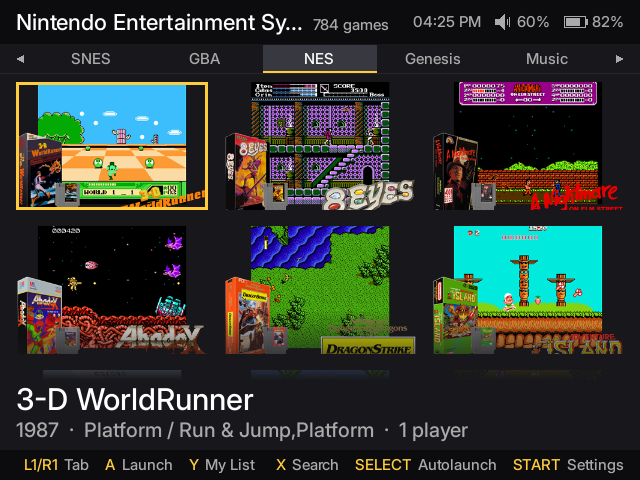 | 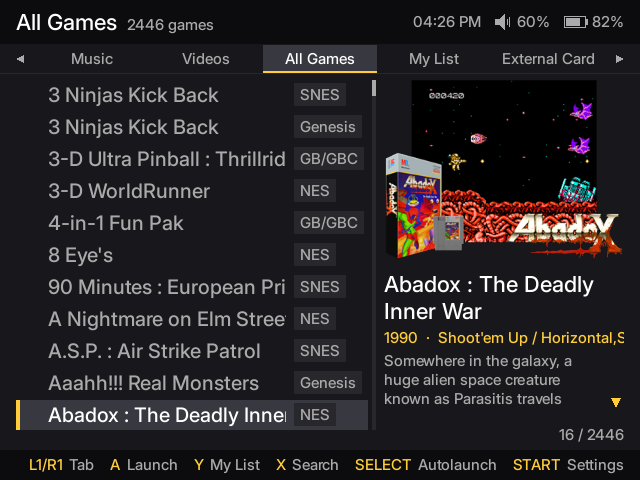 |
| Search (X): the on-screen keyboard filters every tab as you type | |
| 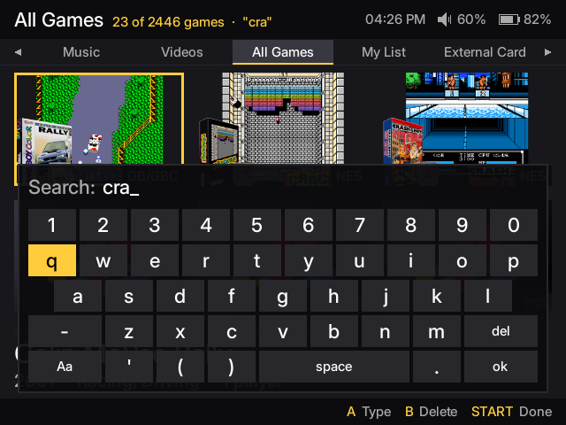 | |

The top bar shows the volume (a headphones icon when the sound goes to the headphones only) and the battery, whose level turns yellow while charging, green when full and red at 10% or less.

Changing the brightness (FN+Vol) or the volume shows a level bar for a moment, and FN + D-pad down shows the audio output. It is drawn by the graphics driver (a patch to Mesa's Gallium HUD), so it looks the same over the launcher, the settings and every game:

| Brightness | Volume | Audio output |
| --- | --- | --- |
| 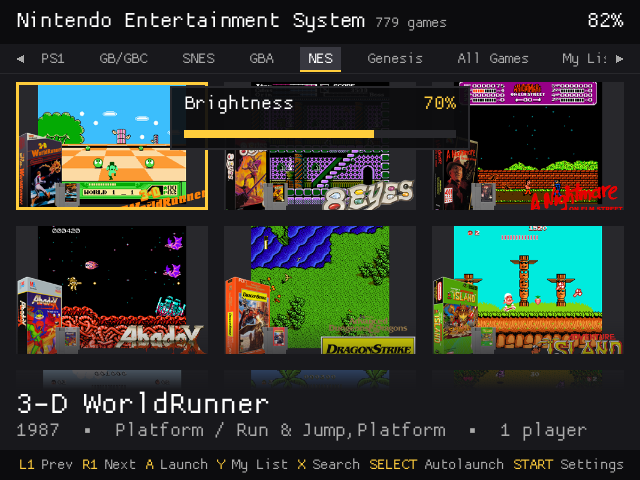 | 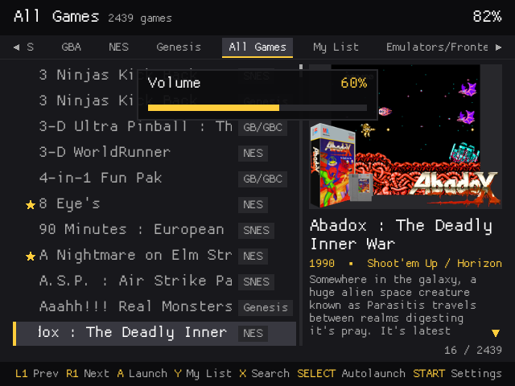 | 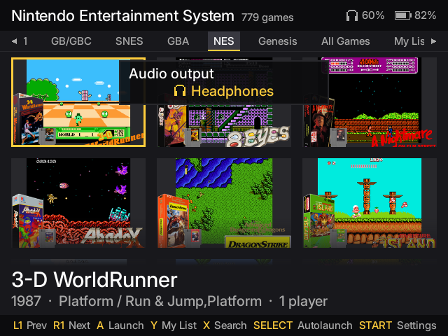 |

It starts up fast, uses very little power, launches applications instantly, and uses zero RAM and CPU after launching an application.

Puppy uses a ini-formatted `apps.puppy` files to populate it's application list. 

Add a new entry by modifying the `apps.puppy` file in your HOME partition. Take a look at the comments at the top of that file for syntax/examples

Works with scraped collections: point Skraper (or anything that writes EmulationStation's `gamelist.xml`) at your rom folders and Puppy shows the games' names, artwork, descriptions and year/genre/players, no conversion needed (see [How do I add games?](#how-do-i-add-games)).

Each system and app category gets its own tab, plus an "All Games" tab with every system's games, a "My List" tab with your favourites and, once you've played something, a "Recent" tab with the last 30 games you opened, newest first. The strip at the top shows five tabs of the same width, the current one in the middle, and wraps around. Controls:

| Button | Action |
|---|---|
| L1 / R1 | Previous / next tab |
| D-pad / left stick | Move (hold to scroll). In list view, left/right jump a page |
| Right stick up/down | Scroll the game's description (list view) |
| A | Launch |
| Y | Add to / remove from My List (your favourites tab) |
| SELECT | Set / clear autolaunch |
| L2 + R2 | Game options: **Rename** the game with the on-screen keyboard, starting from the name it shows (L1/R1 move the cursor, Aa types capitals): the shown name changes and the file takes a version of it the card accepts (":" becomes " -"), with its cover, gamelist entry and RetroArch saves following, or **Move to trash** (`HOME/.trash`; a `.cue`'s tracks and a `.m3u`'s discs go with it). System Settings empties the trash |
| X | Search by name with the on-screen keyboard (the search applies to every tab) |
| B | Clear the search, or close the keyboard / power options |
| START | System Settings |
| POWER | Power options: display off, restart, shut down (these two ask first) |

With System Settings -> Input Settings -> Confirm button on B, A and B swap.

Grid or list view, whether the tabs are shown and which ones are set in System Settings. In list view, a selected name that doesn't fit scrolls to show the rest.

### Shortcuts that work everywhere
| Buttons | Action |
|---|---|
| VOL+ / VOL- | Volume, with an on-screen level bar |
| FN + VOL+ / VOL- | Brightness, with an on-screen level bar |
| POWER | Screen off / on (in the launcher it opens the power options) |
| SELECT + START | Close the active app cleanly (RetroArch saves first) and go back to the launcher |
| FN + SELECT + START | Force close the active app |
| FN + D-pad up | Show / hide a live FPS and CPU overlay |
| FN + D-pad down | Sound on the speaker or on the headphones only (the console can't detect headphones, so this is manual) |

### RetroArch
FN is the hotkey:

| Buttons | Action |
|---|---|
| FN + X | RetroArch menu |
| FN + R1 / L1 | Save / load state |
| FN + LEFT / RIGHT | Previous / next state slot |
| FN + Y | Pause |
| FN + R2 | Fast forward |
| FN + L2 | Screenshot, saved in `HOME/.config/retroarch/screenshots` |
| FN + START | Quit the game |

The same list is in System Settings -> Input Settings, next to a button tester.

### Luanti
Luanti opens on its main menu, trimmed to what works without network: New asks for the world's name (left empty, it takes the next free one) and its game mode, Survival or Creative. As in Minecraft, Creative mode lets you fly, breaks blocks at once and has no damage, hunger or monster attacks. Survival has farm animals (at most 20 at a time) and monsters that come out in the dark: as on Minecraft Bedrock, up to 8 under the open sky and 6 in caves around the player, so a cave below doesn't keep them from the surface, and those left far behind go away as on Java. Slow as Minecraft's, they chase at half the speed of a walking player. A broken block falls to the ground, as in Minecraft, and walking past an item picks it up; one you drop (D-pad down) only after two seconds, so it isn't picked right back, and R1 still picks one up from afar. What lies on the ground goes away after five minutes. A shield, worn with the armor, is held in the left hand, lowered at the bottom left, and blocks as in Minecraft: held up, hits and arrows from the front do no damage and wear only the shield, the monster that hit it is pushed back, and you walk as slow as sneaking. L1 holds it up when there is no block in hand (with a block, L1 still places it, as Minecraft's main hand comes first), and so does sneaking, as on Bedrock; attacking lowers it, as on Bedrock too. Running widens the view a little, as in Minecraft. Minetest Game's binoculars are Minecraft's spyglass now, made at the crafting table from an amethyst shard over two copper ingots; in hand, R1 held (the button that eats) looks through its round lens. Amethyst comes from geodes, as in Minecraft: hollow balls in the stone between 16 and 160 nodes down, calcite outside and amethyst inside, whose clusters give four shards to a pickaxe (two otherwise), and four shards make a block of amethyst. What you hold is posed as in Minecraft too: a sword with its blade up toward the top right corner, a pickaxe or an axe with its head up, a block as a small cube turned to show its top. With "Allow changing the game mode" ticked, a toggle in the inventory switches between the two (a grass block in Creative, a sword in Survival, as in Minecraft's game mode switcher). The console has no mouse cursor, so whenever a menu or the inventory is open, Luanti draws one that the sticks move.

Experience works as in Minecraft: mining coal, lapis lazuli, mese or diamond ore, killing a monster (5 points) or an animal (1 to 3), and taking what the furnace made give green orbs that fly to you and fill the bar above the hotbar, with the level in the middle; a chime marks every fifth level. Dying loses the levels and leaves 7 points a level, 100 at most, in your bones (on the ground when there are none), and they come back to you when you empty them.

The enchanting table, crafted as in Minecraft from a book, two diamonds and four obsidian, enchants tools and swords: each of its three choices costs 1 to 3 lapis lazuli and as many levels, and asks for the level written on it, and up to 15 bookshelves around the table raise the choices to level 30. Fortune works as in Minecraft, on ores only, Silk Touch gives no experience, and the grindstone takes enchantments off. Lapis lazuli is an ore from 32 nodes underground down, only in ground not generated yet, 4 to 9 from each.

Villages appear in ground not generated yet, as in Minecraft: gravel roads crossing at the middle, houses, a blacksmith, a church, a library and wheat fields, with loot in the chests. A villager lives in each house with a bed, and traders stand at work: the armorer (iron and diamond armor, the shield), the toolsmith (enchanted tools and swords), the cleric (lapis lazuli), the librarian (bookshelves and books) and the farmer. They are paid in gold ingots, as Minetest Game has no emeralds, and each one also buys something (coal, iron, paper, wheat...) for gold. Villagers fight the monsters that come into the village.

The inventory's tabs are icons, as in Minecraft. In Creative they sit where Minecraft (Java Edition) puts its own: Building Blocks, Colored Blocks, Natural Blocks, Functional Blocks, Recipes and Search above the panel, and Tools & Utilities, Combat, Food & Drinks, Ingredients, Spawn Eggs and the Inventory below it (there is no Redstone tab, as Minetest Game has no redstone). Each tab's grid has Minecraft's 9 columns and scrolls with R1/L1 or the bar beside it, and the trash next to the hotbar deletes whatever is put in it. Survival has two tabs, the Inventory and Recipes.

Its settings (the gear on the main menu, or START > Settings in a game) open on Video, the render distance as in Minecraft: 4 to 20 chunks of 16 blocks. Fewer chunks make the game faster, and a change made in a game shows at once.

Clicking a text field (a world's name, a setting, a sign, a book, the creative inventory's search) opens the launcher's keyboard: the D-pad moves between keys, B types, A deletes (and closes it when nothing is left), START closes it, SELECT closes it and puts the old text back, L1/R1 move the cursor in the text.

| Buttons | In game | In menus and the inventory |
|---|---|---|
| Left stick | Walk | Move the cursor |
| Right stick | Look around | Move the cursor |
| B (bottom) | Jump | Click (on a text field: the keyboard) |
| A (right) | Sneak (with a shield on: hold it up) | Back |
| X / Y | Inventory | X: right click (half a stack), Y: click |
| R1 / L1 | Dig, eat, look through the spyglass (held) / place (with a shield on and no block in hand, L1 holds it up) | Scroll |
| R2 / L2 | Next / previous item | |
| L3 | Run | |
| D-pad | Up: camera view, down: drop the item, left: fly (Creative mode), right: screenshot | Move the cursor slowly |
| START | Pause menu (Exit to OS goes back to the launcher) | Close |

## System Settings
Opened with START from the launcher, which it is part of: there's no loading screen on the way in or out, and the launcher comes back as you left it. The sections are on the left, and the page of the selected one on the right:

```
System Settings
├── Display & Audio
│   ├── Brightness
│   ├── Master Volume
│   ├── Global Mute
│   └── Audio output: Speaker / Headphones
├── Launcher
│   ├── Show launcher tabs
│   ├── Launcher view: Grid / List
│   └── Launcher tabs ─ which tabs to show
├── Interface
│   ├── Language
│   ├── Font
│   ├── Accent color ─ the highlight colour, from a list of 8
│   └── Show Puppy on loading screens (off: a plain "Loading..." while a game starts)
├── Overlay
│   ├── In-game status bar: Show date
│   ├── Show time
│   ├── Show battery
│   ├── Show audio
│   ├── Show CPU temperature
│   ├── Show power chip temperature
│   ├── Opacity
│   ├── Performance (FN + UP): Show on game start
│   ├── Content: FPS / FPS + CPU
│   ├── Style: Graph / Text
│   └── Position: top or bottom, left or right
├── Date & Time
│   ├── Now: the current date and time
│   ├── 24-hour clock
│   ├── Date format
│   ├── Year, Month, Day, Hour, Minute
│   ├── Set date and time
│   └── Time zone
├── Storage
│   ├── HOME usage
│   ├── Resize Home ─ the card's and HOME's sizes, and the resize
│   ├── Second card: usage, Eject card / Detect card
│   └── Empty trash
├── System
│   ├── Power mode: Battery saver / Balanced / Performance
│   ├── System Info
│   └── Restore default settings
├── Input Settings
│   ├── Confirm button: A (right) / B (bottom)
│   ├── Shortcuts ─ every shortcut
│   └── Button Tester
└── Credits ─ the people who made goodluckOS
```

- **Launcher tabs**: hidden tabs' games still appear in All Games and My List.
- **Font**: Default (Inter), VT323, Pixelify Sans or ProggyClean.
- **Accent color**: the colour of the selection, the buttons in the hints and the bars, and of the volume and brightness feedback in games (from the next game on): yellow (the default), orange, red, pink, purple, blue, cyan or green.
- **In-game status bar**: the CPU temperature, the power chip (AXP223) temperature, the date, the time, the battery and the volume and audio output, each one on or off, in the top right corner of every game, with the launcher's icons; Opacity sets its background. All off by default, so nothing covers the game. The launcher keeps its own top bar.
- **Performance**: the Gallium HUD graphs that FN + D-pad up shows in game. Text only goes at the top.
- Overlay changes apply from the next game on.
- **Date & Time**: the date format and 12/24 hours (12-hour by default) of the launcher's top bar clock, which always shows the date and the time, and of the in-game status bar, which shows what Overlay turns on. The clock chip keeps the time while the console is off, so it only needs setting once; the time zone applies to the launcher right away and to the apps opened afterwards.
- **Resize Home**: expands HOME to fill the rest of the card, at the next boot (it asks first, then restarts). HOME is backed up to RAM while it's resized, so do it right after flashing, before copying your games.
- **Empty trash**: deletes for good the games moved to the trash in the launcher.
- **Power mode**: Balanced (the default) speeds the CPU and GPU up only when a game needs it; Battery saver caps the CPU at 816 MHz and the GPU at 240 MHz, for a longer battery life (heavy PS1 games may slow down); Performance keeps both at full speed. The choice is kept across reboots.
- **Restore default settings**: puts Overlay, Date & Time, the launcher's view, tabs, font and accent color, and the power mode back to the defaults in `/usr/share/goodluck/defaults`, keeping the language, the confirm button, the time zone and the clock.
- **Confirm button**: A (right, the default, as on a Nintendo pad) or B (bottom, as on an Xbox pad) launches and selects, and the other one goes back. The launcher, its hints and the shortcut list change right away. Every app that reads the pad through SDL (the video player, ports) gets the chosen button as its south one, the button these apps confirm and jump with, from the next one you open. Luanti keeps B (bottom) for jumping and clicking either way. RetroArch reads the pad on its own and keeps the buttons as printed, for the games; its menu has its own swap option.
- **Credits**: the people who made goodluckOS, grouped by role (someone with several roles shows under each), from the list of upstream's credits app (`/usr/share/credits/credits.ini`).

UP / DOWN pick a section and A or RIGHT opens its page; there, LEFT / RIGHT change the selected setting (A opens the list of choices, or turns a switch on or off), B goes back, and L1 / R1 go to the previous / next section from anywhere. START closes System Settings, and POWER opens the power options here too. A change applies and is saved right away, the language and the font included. A page scrolls with the d-pad when it doesn't fit the screen.

VT323 and Pixelify Sans are under the SIL Open Font License and ProggyClean under the MIT License; their license files are next to them in `/usr/share/fonts`.

| Sections, with Display & Audio | Launcher tabs |
| --- | --- |
| 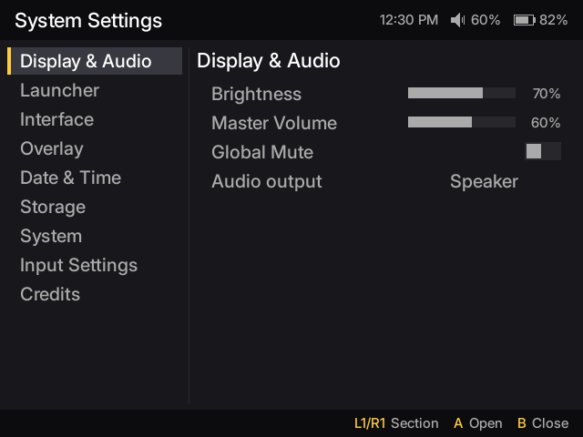 | 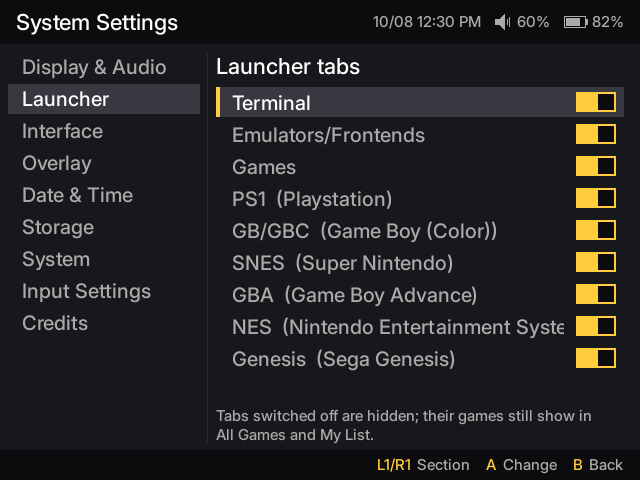 |
| Overlay | In-game status bar |
| 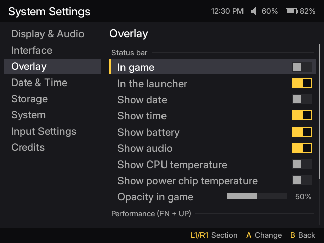 | 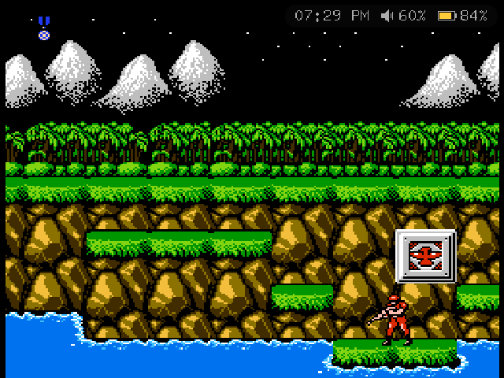 |
| Date & Time | Performance overlay in game (FN + D-pad up) |
| 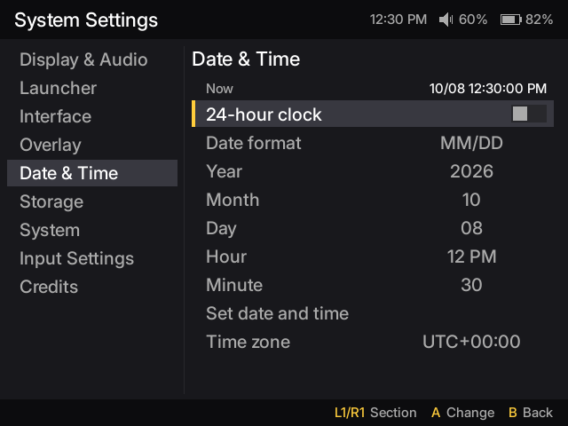 | 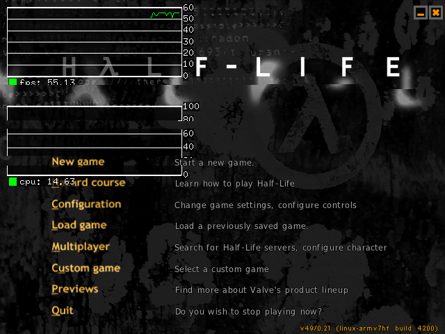 |
| System (Power mode) | Storage: the second card and the trash |
| 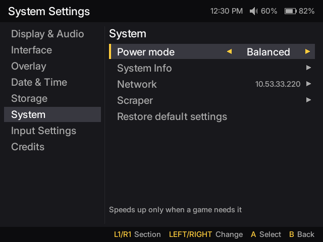 | 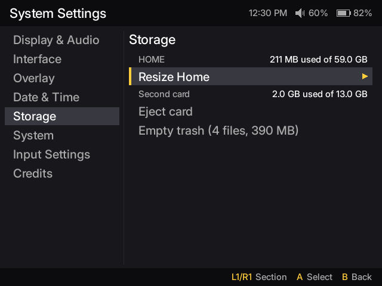 |

## Translations
Every text in the launcher, System Settings included, and in the console's messages ("Restarting...") can be translated, and new languages need no code changes. Languages live in `/usr/share/goodluck/lang/<code>.lang` (in the repository: `rootfs/board/my-device/rootfs-overlay/usr/share/goodluck/lang/`) and show up in System Settings -> Interface -> Language as soon as the file is there.

To add a language:
1. Copy `pt-BR.lang` to a file named after your language's code, e.g. `es.lang` or `fr.lang`.
2. Change the first lines: `language` is the language's own name (`Español`) and `language_en` its English name (`Spanish`).
3. Translate the right side of each `English text = Translation` line. Keep the left side exactly as it is: it's the text that is looked up. Keep `%s` / `%d` where they are, and `\n` for line breaks.
4. Keep the launcher's bottom-bar words short (Tab, Launch, Search...): the bar is nearly full.
5. Optionally add your language's name to the other files (`Spanish = Espanhol` in `pt-BR.lang`), so the selector shows it in every language.

Anything left untranslated simply shows in English. Then open a pull request with the new file.

## What's wrong with the stock firmware?
Stock firmware:
- Based on ancient, unsupported forks of thelinux kernel version 3.4.
- Messy file system, hard to customize, even harder to clean.
- Full of broken/incompatible files.
- Come with inefficient, out-of-date emulator cores.
- Software often not compiled with optimal compiler flags.
- Usually uses swap-on-sd card, which will prematurely kill your expensive microSD card.
- Slow boot time
- Bad/no hotkeys
- Can't be flashed to smaller SD cards.
- The MBR (at least on the GA36-MB) is broken by default. You can't add games unless you manually fix it with my [guide](https://gist.github.com/CodeZombie/83be58b000ee6a14c7b91a6027a8eedf)

## Which chip does my console have?
GA36-MB consoles (sold as R36S) come with an Allwinner A23 or A33, and goodluckOS builds for one don't boot on the other. The stock menu reports a 64-bit CPU and 1 GB of RAM on both, and the marking on the chip can't be trusted either. On Windows, [chip-version](chip-version/README.md) reads the microSD card that came with the console and tells which chip it has.

## How Do I Install goodluckOS?
1. Make an image of the microSD card that came with your device (at least its first 128mb), e.g. with Win32 Disk Imager or `dd if=/dev/sdx of=stock_sdcard.img bs=1M count=128`. It holds your board's boot data, which goodluckOS needs. Keep it: it's also your way back to the stock firmware.
2. Download the goodluckOS image for your SoC from [Releases](https://github.com/CodeZombie/goodluckOS/releases) (A33 and A23 builds are not interchangeable) and extract it
3. Open the [Firmware Builder](https://codezombie.github.io/goodluckOS/download.html), load your card image and the goodluckOS image, and download your personalised image. Don't flash the release image directly: without your board's boot data it won't start.
4. Flash your image to a good microSD card of at least 1gb with [balenaEtcher](https://etcher.balena.io/), [Rufus (in DD mode)](https://rufus.ie/en/), [dd](https://man7.org/linux/man-pages/man1/dd.1.html), etc
5. Plug the micro SD card into TF Slot 1 (TF1-OS) on your GA36-MB and power it on.
6. [optional] In System Settings -> Storage, `Resize Home` expands your HOME partition to fill all the remaining space on your SD card. Do it before copying your games: HOME is backed up to RAM while it's resized. You only need to do this once.

## How do I add games?
Plug the console into your PC with a USB cable and open `goodluckOS -> HOME` (Windows: This PC; Linux: your file manager; macOS needs an MTP app such as [OpenMTP](https://openmtp.ganeshrvel.com/)). Or plug the SD card into your PC and open up the HOME partition. In there you'll find a `roms` folder with a few subfolders for each system. Add your roms to those.

If the console was connected to a charger when it booted (no PC), restart it before plugging it into a PC to get MTP; the serial console works either way. Games copied while Puppy is open show up after you reopen it.

Already have a scraped collection (e.g. made with [Skraper](https://www.skraper.net/) for EmulationStation)? Copy it as it is, `gamelist.xml` and `media` folder included: Puppy reads them.

To add custom art to Puppy, add an image file into the `icons` folder in your rom folder with the same name as the rom file. (eg. if your game is `roms/snes/super-mario.smc`, your image would be `roms/snes/icons/super-mario.png`)

Puppy also reads a `gamelist.xml` in the rom folder (as written by Skraper or EmulationStation): it takes each game's name, description, year/genre/players and image from it. An image in `icons` still wins over the gamelist's. With the interface in another language, a `gamelist.<code>.xml` next to it (e.g. `gamelist.pt-BR.xml`, written by a scraper pass in that language) supplies that language's names, descriptions and genres; images and anything it lacks still come from `gamelist.xml`. Big images are scaled down once and cached in `~/.cache/puppy/thumbs`.

### Second card (TF-2 slot)
A FAT32 card in the second slot shows up in the launcher, in its own External Card tab and in each system's tab. The card is found when the console starts; to swap it with the console on, use System Settings -> Storage: Eject card before taking it out, and Detect card after putting one in. Put the games in a `roms` folder with the same system folders as HOME (`roms/snes`, `roms/psx`, `roms/gba`...), and covers in each folder's `icons`. A card with no `roms` folder gets the folders created the first time it's mounted; existing folders and files are never touched. Music and videos go in `media/music` and `media/videos`.

Puppy finds games by folder, not by file type: games loose on the card, or in the wrong system's folder, won't show up or won't start. exFAT cards (most cards over 32 GB come that way) aren't read yet, so format the card as FAT32.

### Can I add my own archives?
You sure can!

To add a new emulator, find an appropriate armhf libretro core .so file (e.g. from the [libretro buildbot](https://buildbot.libretro.com/nightly/linux/armhf/latest/)). Add it to either:
1. The `/usr/lib/libretro` folder in the `linux` partition, or
2. Anywhere in your HOME partition, e.g. a `cores` folder

Then modify `HOME -> apps.puppy` with a new `[ARCHIVE]` entry, pointing the COMMAND to your new libretro core. Take a look at `HOME -> apps.puppy` for an exmaple.

## How do I add music and videos?
Copy them into `HOME -> media -> music` and `HOME -> media -> videos`. The Music and Videos tabs show up in the launcher once there's something in them. A folder (an album, a series) is one entry that plays whole, with its `cover.jpg` or `folder.jpg` as the art; a single file plays along with the rest of its folder. Other art goes in the `icons` folder, named like the file or folder.

Controls (also in System Settings -> Input Settings -> Shortcuts):

| Button | Action |
|---|---|
| A / START | Pause |
| B | Quit |
| D-pad left / right, left stick left / right | Back / forward 10 s |
| D-pad down / up | Back / forward 1 min |
| L1 / R1 | Previous / next file |
| X | Show the playlist |
| Y | Repeat on / off |
| L2 / R2 | Audio / subtitle track |
| Left stick up / down | Faster / slower: 0.25x, 0.5x, 1x, 1.5x, 2x. The speed stays for the next files of the playlist |
| R3 / L3 (press the stick) | Zoom in / out: 1x, 1.5x, 2x, 3x, 4x |
| Right stick | Move the zoomed picture, up to its edges |
| SELECT | Back to normal speed and zoom |

With the confirm button on B, A and B swap here too.

The A33 decodes video in software: up to 640x480 H.264 plays smoothly, 1080p and H.265 don't. Convert bigger videos on your PC first, e.g. `ffmpeg -i in.mp4 -vf scale=640:480:force_original_aspect_ratio=decrease:force_divisible_by=2 -c:v libx264 -tune fastdecode -crf 23 -c:a aac -ac 2 out.mkv`. On Windows, [convert-videos](convert-videos/README.md) does this for a whole folder, turns portrait videos to fill the screen and saves a frame of each one as its art.

## Does goodluckOS come with any games?
Doom, through Chocolate Doom, and Luanti with Minetest Game (both free software).

goodluckOS will never be distributed with unauthorized copyright protected materials. If you own the copyright to any games or demos (or know of any permissively-licensed/CC games) that you think might make a good fit, please open an Issue! I'd love to include some high quality games with the OS by default.

## About Ports
Some subset of portmaster games could theoretically work, however I want to tamper your expectations a little bit before we all start getting too excited.
The Allwinner A23/A33 is a 32-bit SoC. This means that 64-bit software simply _cannot_ run on it. There are a number of popular android ports that exist only as aarch64 (64-bit) distributions. Those will never work. Additionally, even with ZRAM there, the device is still heavily RAM-limited, so unoptimized games (I'm looking at you, Balatro) will struggle to run without patching.

With that said, most of the games people actually care about (Stardew Valley, Half-Life 1, n64 re-comps, Android GameMaker games, OpenMW, OpenRCT2, + more) are 32-bit games, and therefore should theoretically work if anyone cares to create 32-bit ports.

## How Do I Build It?
GoodluckOS uses a novel four-step containerized build system featuring Buildroot. This means the OS can be configured and built extremely easily and portably with no extra dependencies at all besides Docker and Docker Compose (or Podman).

Take a look at [BUILD.MD](BUILD.md) for instructions and guidelines.

## Design Philosophy
goodluckOS has been designed with a few core principles:
- The core OS will ship with at most one tool for any job. Duplicate functionality is duplicate bugs.
- goodluckOS should strive to be as battery-efficient as possible. If a not-strictly-necessary pretty UI feature uses more resources than an uglier alternative, the uglier alternative will be preferred.
- Do not reinvent the wheel. Opt to use existing packages instead of writing them from scratch so long as they don't conflict with the previous principles.
- Anything not usable by most people should be distributed as an installable package instead of being baked into the core OS.

Please keep those in mind if you intend for your work to be merged upstream :)

I am currently in the process of choosing a package-management solution for goodluckOS, so if your application/feature is not approved for merging upstream, please feel free to package it up as an installable application and I will be happy to advertise it as an optional feature for goodluckOS users.

## AI Contribution Policy
Contributors should feel free to use any tool at their disposal to write their code. Good code is good code regardless who (or what) wrote it. However, large systems that have not been properly tested, documented, or are not understood by the human contributors will _not_ be accepted until all of these conditions are met. This rule applies to both human written code and LLM-generated code.

## LICENSE
This project is licensed under the GNU GENERAL PUBLIC LICENSE VERSION 2.0 see the [LICENSE](LICENSE) file for details.

## DISCLAIMER
**WARNING**: The GNU General Public License v2 covers this in more detail, but to re-iterate: This software has the potential to permanently damage your hardware. You alone are responsible for _all_ damages, and the ensuing results of said damages that may occur as a result of using, or attempting to use this software.
