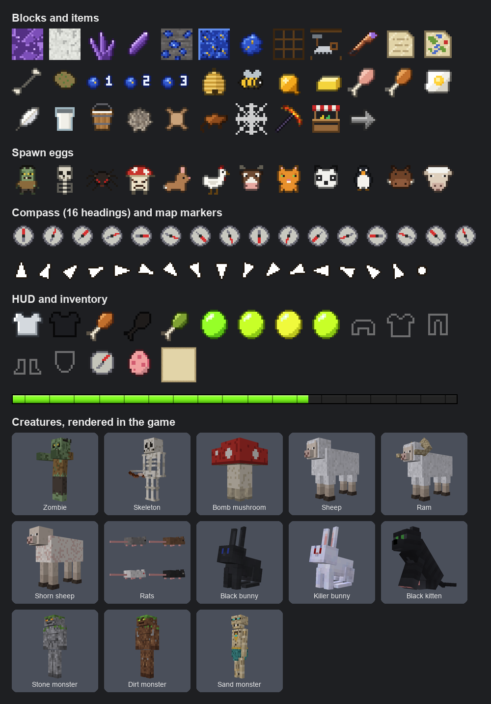

# Ports

Games that run natively on the console, not in an emulator: PC versions built for its 32-bit ARM CPU and its OpenGL ES 2 GPU. Apart from Luanti, none of them comes with its game: you supply your own copy (the game's files or the cartridge's ROM), and nothing from the games is in this repository.

All four are work in progress and have only run on my console (GA36-MB, A33, 512 MB of RAM). The screenshots are from it.

| Game | Built on | You supply | On the A33 | Where |
| --- | --- | --- | --- | --- |
| [Luanti](#luanti) | Luanti 5.17 with 27 patches, Minetest Game, 37 mods | nothing | 20 FPS in a forest, 10 over a lake | branch `feat/luanti-xp` |
| [Stardew Valley](#stardew-valley) | Mono, MonoGame, gl4es | the game, from Steam | about 19 FPS on the farm | `dev/stardew` |
| [Ocarina of Time](#ocarina-of-time) | Ship of Harkinian 9.3.0 | your ROM | 20 FPS, as on the N64 | `dev/zelda` |
| [Majora's Mask](#majoras-mask) | 2 Ship 2 Harkinian 5.0.1 | your ROM | not measured yet | `dev/zelda` |

## Installing a port

A port is a folder in `HOME/ports/` and an entry in `HOME/apps.puppy`, which puts it in the launcher's Games tab and, tagged "Ports", in All Games. The launcher reads `apps.puppy` when it starts, so restart the console after editing it.

There are no downloads: the games can't be shared, and this fork has no releases. Each port is built on a PC, in the dev container of [dev/README.md](../../dev/README.md) (Docker, on Intel or Apple Silicon; `dev/gl image` once). The result holds your game's files, so it is for your own console only.

The examples copy to the card in a card reader on a Mac (`/Volumes/HOME`). MTP works too, at ~10 MB/s. Before ejecting, `dot_clean /Volumes/HOME` removes the `._` files macOS leaves on FAT.

## Luanti


Luanti is an open-source engine for Minecraft-like games, and Minetest Game, its classic game, is free. Here both run on a 512 MB handheld with a Mali-400: 27 patches make the engine fast enough and fit it to a gamepad and a 640x480 screen, and 37 mods, 21 of them written for goodluckOS, bring the game close to classic Minecraft: Survival or Creative, hunger, armor and shields, the classic monsters, villages with traders, experience and enchanting, a bow, a compass, maps and a spyglass. At 640x480: 20 FPS in a forest, 10 to 11 looking across a lake, capped at 30.

**Install:** Luanti is part of the system image (a Buildroot package), so there is nothing to copy. Build the rootfs from `feat/luanti-xp` and write it to the card (`dev/gl rootfs`, `dev/gl ext4`, `dev/sdcard-mac.sh`, see [dev/README.md](../../dev/README.md)), and it shows up in the Games tab. `feat/luanti` doesn't have the classic monsters, the villages, experience and enchanting, the bow, the compass and the maps yet. Worlds and settings are kept in `HOME/.minetest`. The controls are in that branch's README.

### Updating Luanti

Once a card has Luanti, a new version needs no new system image: it comes as one file, a package named `luanti-<date>-<time>-<commit>.tar.xz` (about 10 MB). A package holds all of Luanti, the engine and the game, so it installs over any older version, without the ones in between.

1. Copy the package to the `updates` folder of HOME, over USB (the console is an MTP device: Windows shows it as a drive) or with the card in a card reader:

   ```sh
   cp luanti-20261017-1610-3a390df.tar.xz /Volumes/HOME/updates/
   dot_clean /Volumes/HOME
   ```

2. In the launcher's Games tab, run **Update Luanti**, right below Luanti. It shows each step on the screen, takes about 20 seconds, and goes back to the menu by itself.

If the new version misbehaves, **Undo Luanti update**, below it, brings back the one installed before; running it again returns to the update.

Worlds and settings in `HOME/.minetest` are never touched. Before it changes anything, Update Luanti checks every file of the package against the package's checksums, that the package holds only Luanti's files and all of them, and that the system has room for it; if any check fails, nothing changes. A package older than the installed version, or the same one, is refused. With several packages in the folder it installs the newest and moves the others to `updates/old`; the installed one goes to `updates/installed`. Each step is written to `HOME/logs/luanti-update.log`.

Update Luanti is part of the system image built from `feat/luanti-xp`: a card with an older image needs that image first, or gets Update Luanti from a PC over USB. This fork publishes no packages yet; `dev/gl luanti-pkg` makes them on a PC from any commit of the branch ([dev/README.md](../../dev/README.md#luanti-packages)).

### The engine: Luanti 5.17 for handhelds

The engine is Luanti 5.17.0 (celeron55 and contributors; code LGPL-2.1+, media CC BY-SA 3.0) with the commits of the `handheld/5.17` branch of [alvesmaicon/luanti](https://github.com/alvesmaicon/luanti/tree/handheld/5.17), which Buildroot applies as patches (`rootfs/package/luanti/`). `feat/luanti-xp` builds 5.17.0-handheld.10. The patches are under Luanti's license. They were written with AI assistance, which Luanti's AI policy doesn't accept, so they stay in that fork; fixes upstream could use are its issues labelled "upstream candidate".

| Scene on the A33, view range 320 | Luanti 5.17.0 | With the patches and the handheld's settings |
| --- | --- | --- |
| Forest, 320x240 | 3.9 FPS, 1.64 M vertices | 28 FPS |
| Lake view, 320x240 | 3.4 FPS, 1.52 M vertices, 11 MB of RAM free and 54 MB in swap | 10 FPS, 0.53 M vertices, 177 MB free, no swap |
| An inventory page of blocks | 138 ms a frame | 33 ms |

| Patch | What it changes |
| --- | --- |
| | **GPU and memory** |
| 0002 | 2D batches drawn with `glDrawElements`, so menus have text on GLES 2 |
| 0005 | Index buffers created as such, so lima caches their index range: the CPU work per vertex drops about 20 times |
| 0006 | Fog without overflow on GPUs with only 16-bit floats, where everything past 25.6 nodes took the fog's color |
| 0007 | Fog computed per vertex in the nodes shader |
| 0008 | Nodes drawn as opaque cubes, opaque leaves too, hide what is behind them |
| 0009 | Blocks out of view are unloaded too, and kept alive below 5 FPS |
| 0010 to 0013 | Far terrain drawn from simplified meshes (one cube per 2x2x2 nodes, equal faces merged, detail back when close), on by default |
| 0019 | Blocks in the inventory and the hotbar share one depth clear a frame instead of one each |
| 0020 | The HUD isn't drawn under a menu |
| 0027 | The loading screen waits for the terrain in view, so a world opens complete |
| | **Gamepad and screen** |
| 0001 | Without a cursor plane, the gamepad moves a drawn cursor in menus |
| 0004 | Fixed-size forms fit screens under 800x600 |
| 0016, 0025 | An on-screen keyboard for the gamepad, whose OK is the field's Enter |
| 0024 | The right stick scrolls menus, the left one moves the cursor |
| | **Menus** |
| 0015 | A main menu without what needs a network or a keyboard |
| 0014, 0017, 0026 | A new world asks for its name, Survival or Creative (a button, as in Minecraft) and a bonus chest |
| 0018 | Settings open on a Video page with the render distance in chunks |
| 0021 | The world list takes the whole width |
| | **In game** |
| 0022 | The off-hand item, a shield, is held in the left hand, lowered or raised |
| 0023 | The held item's rest pose is a setting, posed as in Minecraft at 640x480 |
| | **System** |
| 0003 | Text converted with UCS-4, which minimal glibc builds have built in |

### The game: Minetest Game and 37 mods

Every mod sits in the game's `mods/` folder, so every world has them. The branch's `rootfs/package/luanti-game/CREDITS.txt` says where each one comes from, under which licenses, and which files goodluckOS leaves out or replaces; each mod keeps its own license file.

| Mod | Author | Version | License | Here |
| --- | --- | --- | --- | --- |
| [Minetest Game](https://github.com/luanti-org/minetest_game) | celeron55 and contributors | c42e4d0 | code LGPL-2.1+, media CC BY-SA 3.0 and others | the game, 34 mods |
| [Mobs Redo](https://codeberg.org/tenplus1/mobs_redo) | TenPlus1 | b1be18b | MIT; media CC0, CC BY-SA 3.0 | animals and monsters |
| [mobs_animal](https://codeberg.org/tenplus1/mobs_animal) | TenPlus1, Krupnov Pavel | ae70977 | MIT; media CC0, WTFPL, MIT, CC BY-SA 3.0 | farm animals |
| [mobs_monster](https://codeberg.org/tenplus1/mobs_monster) | TenPlus1 | 0185683 | MIT; media CC0, WTFPL, MIT, CC BY-SA 3.0 and 4.0 | not spawned: the spider's model and sound |
| [mobs_npc](https://codeberg.org/tenplus1/mobs_npc) | TenPlus1, MirceaKitsune (model) | 4d6096d | MIT; model CC BY-SA 3.0, textures CC BY-SA 3.0 and 4.0, CC0 | villagers and traders |
| [stamina](https://codeberg.org/tenplus1/stamina) | BlockMen, Auke Kok, TenPlus1 | 4b6988d | LGPL-2.1+; media CC BY 3.0, WTFPL, CC0 | hunger |
| [3d_armor](https://github.com/minetest-mods/3d_armor) | Stuart Jones, davidthecreator (textures) | a4f311c | LGPL-2.1; textures CC BY-SA 3.0, sounds CC0 | armor and shields, 9 of its mods |
| [x_enchanting](https://bitbucket.org/minetest_gamers/x_enchanting) | SaKeL | 1.9.3 | LGPL-2.1+; media CC BY-SA 4.0, sounds CC0, CC BY 3.0 and 4.0 | the enchanting table |
| [x_bows](https://bitbucket.org/minetest_gamers/x_bows) | SaKeL | 5.3.1 | LGPL-2.1+; media CC BY-SA 4.0 and 3.0, sounds CC0 | bow and arrows |
| [villages_mtg](https://content.luanti.org/packages/Drix03/villages_mtg/) | Drix03 | 1.0.3 | MIT | its eight buildings, in goodluck_villages |

The 21 `goodluck_*` mods are goodluckOS's, under its license (GPL-2.0):

| Mod | What it does |
| --- | --- |
| goodluck_amethyst | Amethyst geodes underground: calcite, amethyst and clusters that give shards |
| goodluck_bonus_chest | Minecraft's bonus chest by the spawn, when the world is made with it |
| goodluck_bow | x_bows' bow played as Minecraft's: L1 held draws it, letting go shoots; arrows come from the inventory and are picked up by walking into them |
| goodluck_compass | The compass points to the world's spawn; held, it shows where you are |
| goodluck_craft | Minecraft's inventory: armor and player on the left, a 2x2 grid, the 3x3 one at a crafting table, creative items in tabs |
| goodluck_creative | Survival or Creative, chosen with the world and switched in game when allowed |
| goodluck_crouch | Sneaking lowers the camera |
| goodluck_enchanting | The enchanting table paid in lapis lazuli and levels, Fortune only on ores |
| goodluck_hud | Minecraft's survival HUD: armor above the hearts, hunger beside them, the XP bar below |
| goodluck_hunger | Minecraft's hunger costs: walking, placing and crafting are free |
| goodluck_item_drop | Broken blocks fall to the ground, and walking past an item picks it up |
| goodluck_lapis | Lapis lazuli ore, from 32 nodes down, 4 to 9 lapis each |
| goodluck_map | An empty map becomes the map of where you are, drawn as you go |
| goodluck_mobs | Monsters as slow as Minecraft's, with caps for the surface and for caves, gone when left far behind |
| goodluck_monsters | The classic night monsters: zombie, skeleton with a bow, spider and, in the creeper's place, the bomb mushroom |
| goodluck_shield | The shield, held up with L1 or by sneaking, blocks hits and arrows from the front |
| goodluck_solid_leaves | Opaque leaves that don't wave drawn as plain cubes |
| goodluck_sprint | L3 runs, with a slightly wider view |
| goodluck_spyglass | Minetest Game's binoculars become Minecraft's spyglass, made with an amethyst shard and copper |
| goodluck_villages | Villages with roads, houses, a blacksmith, a church, a library and fields, loot in the chests, villagers and traders paid in gold |
| goodluck_xp | Experience: orbs from ores, monsters and the furnace, levels spent at the enchanting table, part of them left in the bones |

### Art made for goodluckOS



133 textures, 21 sounds and 2 models were made for this port, under goodluckOS's license (GPL-2.0). Most are new things: amethyst, lapis, the compass and the maps, experience, the HUD, the classic monsters. The others replace media that wasn't free or had no credit: the sheep's textures were CC BY-NC-SA 4.0 (non-commercial only), the rat was credited only as "CCPL", the bow's sounds named no license, and some items had no credit at all. A few are recolors of free art (the black and killer bunnies, the black kitten), and the stone, dirt and sand monsters are redrawn for mobs_monster, which stays in the game for the spider's model. Not in the grid: the spider's skin, a recolor of AspireMint's (CC BY-SA 3.0), and the half-drawn bow, redrawn from x_bows' (CC BY-SA 4.0). The lapis ore is drawn over Minetest Game's stone.

## Stardew Valley


The PC build from Steam's "compatibility" branch (1.6.15) is a .NET Framework program, so it runs on Mono, built here for 32-bit ARM. PortMaster's port supplies the rest: JohnnyonFlame's MonoGame, which streams the music from the card instead of RAM, and gl4es, which turns the game's OpenGL into OpenGL ES 2. Our patches cut work the game repeats every frame, and the save serializers are generated ahead of time. About 19 FPS on the farm, the title screen in ~25 s, a save loaded in ~75 s.

**You supply:** Stardew Valley on Steam, switched to the compatibility branch (Properties > Betas > compatibility), in its macOS or Linux version (the one with `StardewValley.exe`). Tested with the macOS one.

**Build and install** (`SDV_GAME` is the game's folder; Steam's on a Mac is the default):

```sh
dev/stardew/build.sh          # the port in dev/out/stardew/stardewvalley, its patches built against your game
dev/stardew/build.sh game     # your game's files in dev/out/stardew/gamedata, the .xnb ones recompressed as LZ4
dev/stardew/build.sh xmlgen   # the save serializers, into gamedata
mkdir -p /Volumes/HOME/ports
cp -R dev/out/stardew/stardewvalley /Volumes/HOME/ports/
cp -R dev/out/stardew/gamedata/. /Volumes/HOME/ports/stardewvalley/gamedata/
```

Add to `HOME/apps.puppy`:

```ini
[ENTRY]
CATEGORY=Games
NAME=Stardew Valley
DESCRIPTION=Your own game files, compatibility branch
COMMAND=sh /home/player/ports/stardewvalley/stardew.sh
ICON=/home/player/ports/stardewvalley/icon.png
```

The icon comes from your game's title logo, and the game follows the launcher's language. Log: `HOME/logs/stardew.log`.

**Credits:** Stardew Valley is ConcernedApe's, and the copy is yours. The port is built on [PortMaster's](https://github.com/PortsMaster/PortMaster-New) port of the game: JohnnyonFlame's MonoGame with streamed audio (the MonoGame Team, Ms-PL) and his loader and game patches (BSD), [gl4es](https://github.com/ptitSeb/gl4es) by ptitSeb and Ryan Hileman (MIT), [Mono](https://www.mono-project.com/) (MIT, some parts BSD-3-Clause), [OpenAL Soft](https://github.com/kcat/openal-soft) (LGPL 2) and [lz4](https://github.com/lz4/lz4) (BSD-2-Clause). PortMaster's license files stay in the port's folder.

## Ocarina of Time


Ship of Harkinian is the PC port built from the decompiled N64 game. Its renderer needs OpenGL ES 3, which the Mali-400 lacks, so this port brings one written for OpenGL ES 2, plus a fix for 32-bit builds, where the sky, the logo and the text went missing. It runs at 480p and 20 FPS, the frame rate of the N64 cartridge, with the cartridge's look by default.

**You supply:** your Ocarina of Time ROM as `.z64`, in a version Ship of Harkinian supports (N64 1.0 to 1.2 or PAL, or GameCube, Master Quest included). Tested with the N64 USA 1.0.

**Build and install:**

```sh
dev/gl rootfs                      # once, 1-2 h: the port brings only the libraries the console lacks
mkdir -p dev/out/zelda/roms/oot
cp "Legend of Zelda, The - Ocarina of Time (USA).z64" dev/out/zelda/roms/oot/
python3 dev/zelda/cover.py         # optional: launcher icons for both games, from libretro-thumbnails (needs Pillow)
GL_JOBS=3 dev/zelda/build.sh oot   # dev/out/zelda/soh.tar, ~40 min on an M1
mkdir -p /Volumes/HOME/ports && tar -xf dev/out/zelda/soh.tar -C /Volumes/HOME/ports
```

Add to `HOME/apps.puppy`:

```ini
[ENTRY]
CATEGORY=Games
NAME=Ocarina of Time
DESCRIPTION=Ship of Harkinian, from your own rom
COMMAND=sh /home/player/ports/soh/soh.sh
ICON=/home/player/ports/soh/icon.png
```

Saves and settings stay in `HOME/ports/soh`. Log: `HOME/logs/soh.log`.

**Credits:** [Ship of Harkinian](https://github.com/HarbourMasters/Shipwright) is by HarbourMasters; its repository has no license file. It runs on their [libultraship](https://github.com/Kenix3/libultraship) (Kenix3 and contributors, MIT) and builds its assets with Torch (Lywx, MIT); [libzip](https://libzip.org/) is BSD-3-Clause. The game is Nintendo's, from your own ROM.

## Majora's Mask


2 Ship 2 Harkinian is the same kind of port for Majora's Mask, on the same libraries, so it uses the same OpenGL ES 2 renderer. On the console the title demo plays through Clock Town at 480p; the frame rate isn't measured yet.

**You supply:** your Majora's Mask ROM as `.z64`, the N64 USA version (1.0): 2 Ship 2 Harkinian takes only the USA versions.

**Build and install**, with the rootfs built as for Ocarina of Time:

```sh
mkdir -p dev/out/zelda/roms/mm
cp "Legend of Zelda, The - Majora's Mask (USA).z64" dev/out/zelda/roms/mm/
GL_JOBS=3 dev/zelda/build.sh mm    # dev/out/zelda/2ship.tar
mkdir -p /Volumes/HOME/ports && tar -xf dev/out/zelda/2ship.tar -C /Volumes/HOME/ports
```

Add to `HOME/apps.puppy`:

```ini
[ENTRY]
CATEGORY=Games
NAME=Majora's Mask
DESCRIPTION=2 Ship 2 Harkinian, from your own rom
COMMAND=sh /home/player/ports/2ship/2ship.sh
ICON=/home/player/ports/2ship/icon.png
```

Saves and settings stay in `HOME/ports/2ship`. Log: `HOME/logs/2ship.log`.

**Credits:** [2 Ship 2 Harkinian](https://github.com/HarbourMasters/2ship2harkinian) is by HarbourMasters (CC0), on the same libultraship (MIT), with ZAPDTR (the Zelda Reverse Engineering Team, MIT) and OTRExporter (HarbourMasters, MIT). The game is Nintendo's, from your own ROM.
