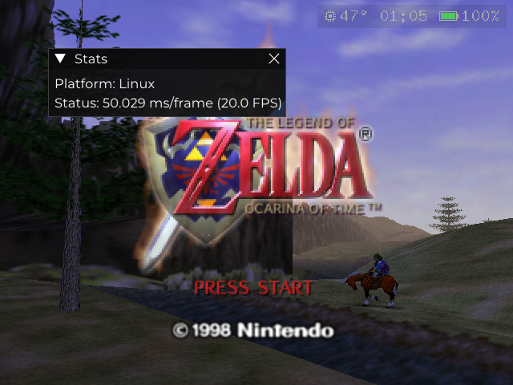
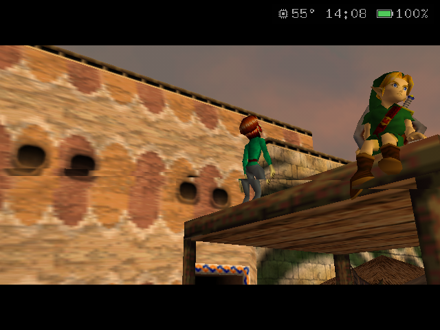

# Ports

Games that run natively on the console, not in an emulator: PC versions built for its 32-bit ARM CPU and its OpenGL ES 2 GPU. Apart from Luanti, none of them comes with its game: you supply your own copy (the game's files or the cartridge's ROM), and nothing from the games is in this repository.

All four are work in progress and have only run on my console (GA36-MB, A33, 512 MB of RAM). The screenshots are from it.

| Game | Built on | You supply | On the A33 | Where |
| --- | --- | --- | --- | --- |
| [Luanti](https://github.com/alvesmaicon/luanti/blob/handheld/5.18/goodluckos/README.md) | Luanti 5.18 with 51 patches, Minetest Game, 63 mods | nothing (an app) | 20 FPS in a forest, 10 over a lake | [alvesmaicon/luanti](https://github.com/alvesmaicon/luanti) |
| [Stardew Valley](https://github.com/alvesmaicon/glOSports-stardew#readme) | Mono, MonoGame, gl4es | the game, from Steam (macOS or Linux version) | about 19 FPS on the farm | [alvesmaicon/glOSports-stardew](https://github.com/alvesmaicon/glOSports-stardew) |
| [Ocarina of Time](#ocarina-of-time) | Ship of Harkinian 9.3.0 | your ROM | 20 FPS, as on the N64 | `dev/zelda` |
| [Majora's Mask](#majoras-mask) | 2 Ship 2 Harkinian 5.0.1 | your ROM | not measured yet | `dev/zelda` |

## Installing a port

Luanti and Stardew Valley are apps: their zips install in System Settings -> System -> App Installer. The Zeldas are each a folder in `HOME/ports/` and an entry in `HOME/apps.puppy`, which puts it in the launcher's Games tab and, tagged "Ports", in All Games. The launcher reads `apps.puppy` when it starts, so restart the console after editing it. The entry's `SCREENSCRAPER=` line is the game's id on [ScreenScraper](https://www.screenscraper.fr), for the scraper (System Settings -> System -> Scraper), which finds the game by its name without it.

The Zeldas have no downloads: the games can't be shared, so each one is built on a PC, in the dev container of [dev/README.md](../../dev/README.md) (Docker, on Intel or Apple Silicon; `dev/gl image` once). The result holds your game's files, so it is for your own console only.

The examples copy to the card in a card reader on a Mac (`/Volumes/HOME`). MTP works too, at ~10 MB/s. Before ejecting, `dot_clean /Volumes/HOME` removes the `._` files macOS leaves on FAT.

## Luanti

Luanti is a block-building engine, here with Minetest Game and 63 mods that bring it close to Minecraft. It is an app now, built and documented in [its own repository](https://github.com/alvesmaicon/luanti/blob/handheld/5.18/goodluckos/README.md): copy its zip to `HOME/apps` and install it in System Settings -> System -> App Installer. Nothing of yours to supply.

## Stardew Valley

Stardew Valley's PC build, from Steam's compatibility branch, runs on Mono, MonoGame and gl4es, with patches that cut the work it repeats every frame. It is an app now, built and documented in [its own repository](https://github.com/alvesmaicon/glOSports-stardew#readme): install its zip from [Releases](https://github.com/alvesmaicon/glOSports-stardew/releases) with the App Installer, copy your own game to `HOME` (its folder or a zip of it, the macOS or Linux version) and open Stardew Valley. Its first start brings your game into the app, about 15 minutes on the A33. About 19 FPS on the farm.

## Ocarina of Time



Ship of Harkinian is the PC port built from the decompiled N64 game. Its renderer needs OpenGL ES 3, which the Mali-400 lacks, so this port brings one written for OpenGL ES 2, plus a fix for 32-bit builds, where the sky, the logo and the text went missing. It runs at 480p and 20 FPS, the frame rate of the N64 cartridge, with the cartridge's look by default.

**You supply:** your Ocarina of Time ROM as `.z64`, in a version Ship of Harkinian supports (N64 1.0 to 1.2 or PAL, or GameCube, Master Quest included). Tested with the N64 USA 1.0.

**Build and install:**

```sh
dev/gl rootfs                      # once, 1-2 h: the port brings only the libraries the console lacks
mkdir -p dev/out/zelda/roms/oot
cp "Legend of Zelda, The - Ocarina of Time (USA).z64" dev/out/zelda/roms/oot/
python3 dev/zelda/cover.py         # optional: launcher icons for both games, from libretro-thumbnails (needs Pillow)
GL_JOBS=3 dev/zelda/build.sh oot   # dev/out/zelda/soh.tar, ~40 min on an M1
mkdir -p /Volumes/HOME/ports && tar -xf dev/out/zelda/soh.tar -C /Volumes/HOME/ports
```

Add to `HOME/apps.puppy`:

```ini
[ENTRY]
CATEGORY=Games
NAME=Ocarina of Time
DESCRIPTION=Ship of Harkinian, from your own rom
SCREENSCRAPER=5395
COMMAND=sh /home/player/ports/soh/soh.sh
ICON=/home/player/ports/soh/icon.png
```

Saves and settings stay in `HOME/ports/soh`. Log: `HOME/logs/soh.log`.

**Credits:** [Ship of Harkinian](https://github.com/HarbourMasters/Shipwright) is by HarbourMasters; its repository has no license file. It runs on their [libultraship](https://github.com/Kenix3/libultraship) (Kenix3 and contributors, MIT) and builds its assets with Torch (Lywx, MIT); [libzip](https://libzip.org/) is BSD-3-Clause. The game is Nintendo's, from your own ROM.

## Majora's Mask



2 Ship 2 Harkinian is the same kind of port for Majora's Mask, on the same libraries, so it uses the same OpenGL ES 2 renderer. On the console the title demo plays through Clock Town at 480p; the frame rate isn't measured yet.

**You supply:** your Majora's Mask ROM as `.z64`, the N64 USA version (1.0): 2 Ship 2 Harkinian takes only the USA versions.

**Build and install**, with the rootfs built as for Ocarina of Time:

```sh
mkdir -p dev/out/zelda/roms/mm
cp "Legend of Zelda, The - Majora's Mask (USA).z64" dev/out/zelda/roms/mm/
GL_JOBS=3 dev/zelda/build.sh mm    # dev/out/zelda/2ship.tar
mkdir -p /Volumes/HOME/ports && tar -xf dev/out/zelda/2ship.tar -C /Volumes/HOME/ports
```

Add to `HOME/apps.puppy`:

```ini
[ENTRY]
CATEGORY=Games
NAME=Majora's Mask
DESCRIPTION=2 Ship 2 Harkinian, from your own rom
SCREENSCRAPER=5394
COMMAND=sh /home/player/ports/2ship/2ship.sh
ICON=/home/player/ports/2ship/icon.png
```

Saves and settings stay in `HOME/ports/2ship`. Log: `HOME/logs/2ship.log`.

**Credits:** [2 Ship 2 Harkinian](https://github.com/HarbourMasters/2ship2harkinian) is by HarbourMasters (CC0), on the same libultraship (MIT), with ZAPDTR (the Zelda Reverse Engineering Team, MIT) and OTRExporter (HarbourMasters, MIT). The game is Nintendo's, from your own ROM.
